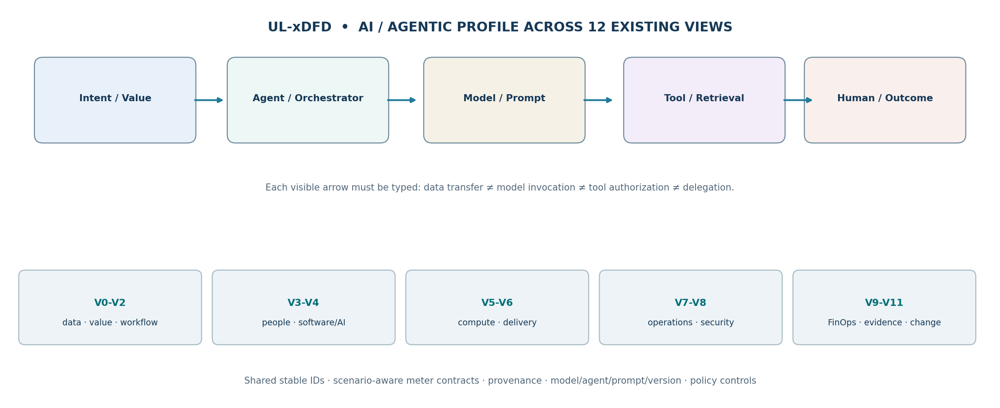
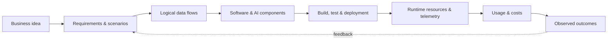
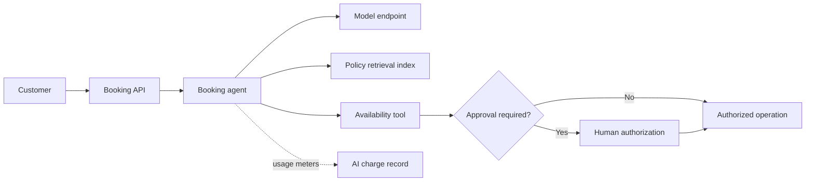

# UL-xDFD

**Unified Lifecycle Extended Data Flow Diagram**  
*An annotation-driven, evidence-aware metamodel for
end-to-end software engineering, cloud, FinOps, delivery optimization, and adoption research*


## Contents

- [The problem](#the-problem)
- [What we want to achieve](#what-we-want-to-achieve)
- [Our proposal](#our-proposal)
- [How UL-xDFD works](#how-ul-xdfd-works)
- [The twelve modeling views](#the-twelve-modeling-views)
- [Working with AI and autonomous agents](#working-with-ai-and-autonomous-agents)
- [From a diagram to useful analyses](#from-a-diagram-to-useful-analyses)
- [Getting started](#getting-started)
- [Documentation](#documentation)
- [Case Studies](#case-studies)
- [Repository layout](#repository-layout)
- [Scientific and standards foundations](#scientific-and-standards-foundations)
- [Current implementation and limitations](#current-implementation-and-limitations)
- [Research roadmap](#research-roadmap)
- [Contributing and citation](#contributing-and-citation)

## The problem

A project starts with an idea, not with a server. Before it reaches production, people have to understand the business need, define requirements, choose an architecture, build and test software, provision resources, operate the system, respond to incidents, and pay for all of it. Modern products also rely on external AI APIs, models, agents, tool servers, retrieval indexes, and human approval steps.

We want to answer questions that span this entire journey:

- **Before building:** What resources and engineering work might this application require? How uncertain are those estimates?
- **Before adopting a practice:** Is this product or organization ready to adopt DevOps, DevSecOps, MLOps, LLMOps, or AgentOps? What evidence supports that diagnosis?
- **During delivery:** Which pipeline stages, security checks, or deployment strategies can be improved without violating policy or quality requirements?
- **In production:** Where does the money go—cloud infrastructure, AI inference, vector search, delivery pipelines, human review, and shared services? What does a successful business outcome actually cost?
- **When changing the system:** What trade-offs are introduced by a new architecture, provider, model, agent autonomy policy, or operational practice?

A traditional **Data Flow Diagram (DFD)** is a useful starting point: it shows how information enters a system, moves between processes, and reaches data stores. However, the arrows do not tell us how often those operations run, how long they take, who is accountable, how components are deployed, what they cost, or whether adoption is likely to succeed. A data-flow arrow also cannot safely stand in for a workflow dependency or an agent's permission to act.

Collecting all this knowledge in separate diagrams, spreadsheets, interviews, and billing exports makes it difficult to keep assumptions consistent. UL-xDFD is our proposal for linking those artifacts without losing their different meanings. See [the full problem statement](docs/technical/01-problem-and-objectives.md).

## What we want to achieve

UL-xDFD has three research goals and one engineering goal:

1. **Prediction and estimation.** Describe demand and forecast capacity, project effort, technology spending, AI consumption, and business-unit economics under explicit scenarios. The model records uncertainty and must be calibrated with observations.
2. **Optimization.** Compare architectures, resource plans, deployment strategies, security pipelines, and AI model/agent choices under cost, quality, security, compliance, and operational constraints.
3. **Adoption and organizational readiness.** Diagnose requirements and gaps for DevOps, DevSecOps, and AI-related operating practices using stakeholder evidence and observable delivery capabilities; investigate predictive validity later with independent longitudinal outcomes.
4. **Reusable tooling.** Provide a machine-readable, inspectable way to connect business requirements, data flows, source code, CI/CD, infrastructure, billing, risk controls, and measured results.

The distinction matters: a **forecast** is not an invoice, a **diagnostic readiness profile** is not a proven probability of adoption success, and an **optimized scenario** is not an independently verified operational improvement.

## Our proposal

**UL-xDFD extends a conventional DFD with typed relations and evidence-backed annotations.** It does not try to show every fact in one overloaded picture. Instead, a single canonical model is presented through twelve linked views, each designed for a different question and stakeholder.

The basic vocabulary is still recognizable: **external entities**, **processes**, **data stores**, and **directed data flows**. Around that core we add requirements, lifecycle activities, workflow events, teams, pipelines, deployable components, resources, charges, evidence, decisions, and AI-specific elements.

We use three principles throughout:

- **One meaning per relationship.** Sending booking data, triggering a deployment, owning a service, charging an account, and authorizing an agent tool call are different relationships.
- **Every significant number has context.** A value such as `1500 tokens`, `8 GiB`, or `$120` needs a unit, period or scenario, scope, source, and evidence status.
- **The model should tell us what is missing.** Unknown, disputed, estimated, observed, and hypothetical values must stay distinguishable, especially when assessing readiness or predicting costs.



Read the [formal metamodel](docs/technical/04-formal-metamodel.md), [element catalog](docs/technical/05-elements-edges-notation.md), and [universal annotation contract](docs/technical/06-annotation-contract.md).

## How UL-xDFD works

A typical project models a value stream and follows its evidence through the lifecycle:



This chain is a **trace of artifacts**, not an assertion that development happens sequentially. Agile iterations, parallel work, retries, and operations can be represented explicitly in the workflow view.

A model is usually assembled in five passes: define boundaries and scenarios; draw the logical DFD; link requirements and people; annotate workload/resources/AI controls; then attach measurements, finance records, and evidence. Revisions are frozen as snapshots when used as research baselines. Start with the [modeling guide](docs/modeling-guide.md).

## The twelve modeling views

Every view is a projection of the **same graph**. Stable IDs keep one business process, AI component, or cost-bearing resource connected across diagrams and datasets.

| View | Focus | The question it helps answer |
| --- | --- | --- |
| [V0 — Logical data](docs/technical/03-lifecycle-views-stakeholders.md) | Actors, processes, stores, messages, trust boundaries | Where does data come from and go? |
| [V1 — Demand, value & requirements](docs/technical/03-lifecycle-views-stakeholders.md) | Business units, requirements, acceptance, value hypotheses | Why build this, and how is value defined? |
| [V2 — Workflow, events & time](docs/technical/03-lifecycle-views-stakeholders.md) | Control flow, branching, queues, approvals, retries | What happens, and when? |
| [V3 — People & governance](docs/technical/03-lifecycle-views-stakeholders.md) | Teams, roles, decision rights, culture evidence | Who makes or reviews decisions? |
| [V4 — Software architecture](docs/technical/03-lifecycle-views-stakeholders.md) | APIs, modules, services, repositories, AI endpoints | What implements the logical behavior? |
| [V5 — Capacity & infrastructure](docs/technical/03-lifecycle-views-stakeholders.md) | CPU, GPU, memory, storage, bandwidth, scaling | How much resource capacity is needed? |
| [V6 — Delivery & DevSecOps](docs/technical/03-lifecycle-views-stakeholders.md) | CI/CD, builds, tests, scans, release gates | How is change delivered and verified? |
| [V7 — Operations & reliability](docs/technical/03-lifecycle-views-stakeholders.md) | SLOs, traces, incidents, recoverability, AI quality drift | How does it behave in operation? |
| [V8 — Security & privacy](docs/technical/03-lifecycle-views-stakeholders.md) | Data classification, trust, policies, agent permissions | What could go wrong, and what controls apply? |
| [V9 — FinOps & sustainability](docs/technical/03-lifecycle-views-stakeholders.md) | Cloud, projects, AI metering, allocation, business cost | What do we consume, pay, and gain? |
| [V10 — Evidence & outcomes](docs/technical/03-lifecycle-views-stakeholders.md) | Sources, timestamps, uncertainty, measures, research outcomes | What do we actually know? |
| [V11 — Lifecycle & change](docs/technical/03-lifecycle-views-stakeholders.md) | Phases, decisions, alternatives, snapshots, decommission | What changed, why, and with what effect? |

The separate **lifecycle axis** runs from `L00` (idea) through `L11` (retirement). A view is *not* a phase: V9 can represent forecast cost at design time and measured cost in production. The [lifecycle/view contract](docs/technical/03-lifecycle-views-stakeholders.md) defines both axes.

## Working with AI and autonomous agents

AI is part of the system architecture, not a black-box surcharge added after deployment. The v1.0 proposal models conventional ML, hosted and self-hosted foundation models, inference endpoints, RAG, training/tuning, and agent systems.

For example, the model distinguishes a **model** (`MODEL`) from the endpoint that serves it (`MODELSVC`), an **agent definition** (`AGENT`) from a particular run (`AGRUN`), and an **agent tool** (`TOOL`) from the authorization policy for using it. An agent may query an index (`VINDEX`), call tools, delegate tasks, and require human confirmation (`HITL`) before an irreversible action.



A real agent may take a different branch, repeat a call, or fail. The graph captures **possible and observed behavior**, policy boundaries, and stop limits—not an assertion that the LLM will always follow a fixed path.

For cost analysis, we track provider-billed input/output/cached/multimodal usage separately from estimated tokens; GPU-hours separately from API charges; and retrieval, tool, evaluation, observability, and human-review costs separately from model inference. See [AI modeling](docs/ai-and-agentic.md) and [AI cost metering](docs/finops-and-cost.md).

## From a diagram to useful analyses

The documentation defines workflows for:

- **Workload and capacity scenarios:** request distributions, fan-out, retries, CPU/GPU demand, network transfer, storage growth, queueing assumptions, and failure conditions ([technical methods](docs/technical/09-workload-and-capacity.md)).
- **Cost forecasts and allocation:** project effort, cloud/private infrastructure, pipeline execution, AI billing, shared charges, and cost per verified business outcome ([cost model](docs/technical/10-cost-and-finops.md)).
- **Readiness diagnostics:** stakeholder-backed gaps and control gates, with longitudinal outcome validation required for predictive claims ([readiness model](docs/technical/11-adoption-and-prediction.md)).
- **Optimization studies:** compare feasible alternatives without trading away mandatory security, risk, or SLO constraints ([optimization methods](docs/technical/12-optimization.md)).
- **Scientific validation:** repeatable scenarios, evidence grades, independent assessments, baselines, ablations, and prospective results ([evaluation protocol](docs/technical/16-research-validation.md)).

These are **specified analysis capabilities**, not features already delivered by the starter validator.

## Getting started

The repository includes an initial structural JSON Schema, a synthetic agentic hotel-booking YAML model, and a Python validation script.

```bash
python -m pip install -r requirements.txt
python tools/validate.py examples/hotel-ai.yaml schemas/ul-xdfd-ai-v1.schema.json
```

The validator checks schema constraints, graph references, annotation targets and scope links, some evidence requirements, and numeric-unit presence. It **does not** verify security enforcement, model accuracy, cost reconciliation, agent safety, capacity forecasts, or adoption predictions.

For a guided walkthrough, open [Getting started](docs/getting-started.md) and [the hotel example](docs/technical/15-hotel-case-study.md).

## Documentation

| Start here | More detailed reading |
| --- | --- |
| [Getting started](docs/getting-started.md) | [Complete technical reference index](docs/technical/README.md) |
| [Core concepts and terminology](docs/core-concepts.md) | [Formal graph definition](docs/technical/04-formal-metamodel.md) |
| [Modeling guide](docs/modeling-guide.md) | [Element and edge semantics](docs/technical/05-elements-edges-notation.md) |
| [AI and agentic systems](docs/ai-and-agentic.md) | [AI annotations and validation rules](docs/technical/07-annotation-dictionary.md) |
| [FinOps and AI costing](docs/finops-and-cost.md) | [Workload equations](docs/technical/09-workload-and-capacity.md) |
| [Quality checks](docs/validation.md) | [All proposed rules](docs/technical/08-validation-rules.md) |
| [Standards and protocols](docs/standards-and-references.md) | [Source crosswalk](docs/technical/17-standards-crosswalk.md) |
| [Research and implementation roadmap](docs/roadmap.md) | [Evaluation design](docs/technical/16-research-validation.md) |
| [FAQ](docs/faq.md) | [Glossary and units](docs/technical/appendix-c-units-and-glossary.md) |


## Case Studies

Explore three real-world-inspired case studies demonstrating how UL-xDFD models software systems across their lifecycle, including architecture, data flows, AI components, cloud resource consumption, and FinOps.

| Example | Description | Documentation |
|---|---|---|
| 🚕 **AtlasRide — Moroccan Mobility Platform** | Ride-hailing platform covering booking, GPS tracking, driver dispatch, payments, AI agents, and cloud costs. | [View Example](examples/moroccan-mobility-ul-xdfd.md) |
| 🛒 **SoukNova — AI-Powered E-Commerce** | Digital marketplace integrating microservices, AI shopping agents, inventory, payments, and cost estimation. | [View Example](examples/ai-powered-ecommerce-ul-xdfd.md) |
| 🌱 **CoopCloud — Smart Agricultural Cooperatives** | Agricultural digitalization platform with detailed CPU/RAM requirements, network consumption, AI services, and FinOps analysis. | [View Example](examples/coopcloud-ul-xdfd-cloud-consumption.md) |

Each example includes step-by-step lifecycle modeling, UL-xDFD diagrams, technical annotations, and illustrative resource and cost estimates.

## Repository layout

```text
UL-xDFD/
├── README.md                    # What problem we address and how the tool works
├── docs/                        # Guides, detailed specification and references
│   ├── technical/               # Source-faithful sections 1–18 and appendices
│   └── assets/                  # Diagram used in documentation
├── examples/hotel-ai.yaml       # Synthetic model (not production evidence)
├── schemas/ul-xdfd-ai-v1.schema.json
├── tools/validate.py            # Initial structural validator
├── tests/                       # Validation smoke tests
├── source/                      # Original Word specification for provenance
├── .github/workflows/           # Basic repository checks
├── requirements.txt
├── CONTRIBUTING.md
├── CITATION.md
└── LICENSE-NOTICE.md
```

## Scientific and standards foundations

UL-xDFD reuses ideas from classical DFDs and architecture viewpoints, lifecycle engineering, process modeling, provenance, cloud billing normalization, risk management, and AI protocols. In particular:

- **Lifecycle / architecture:** [ISO/IEC/IEEE 12207:2026](https://www.iso.org/standard/90219.html) and [ISO/IEC/IEEE 42010:2022](https://www.iso.org/standard/74393.html).
- **Finance:** [FinOps Framework](https://www.finops.org/framework/) and [FOCUS 1.4](https://focus.finops.org/what-is-focus/).
- **Trust and evidence:** [NIST AI RMF](https://www.nist.gov/itl/ai-risk-management-framework), [ISO/IEC 42001:2023](https://www.iso.org/standard/42001), and [W3C PROV-O](https://www.w3.org/TR/prov-o/).
- **Instrumentation and interoperability:** [OpenTelemetry GenAI conventions](https://opentelemetry.io/docs/specs/semconv/gen-ai/), [OpenLineage](https://openlineage.io/docs/spec/), [MCP](https://modelcontextprotocol.io/specification/), and [A2A](https://a2a-protocol.org/).

Our proposed notation is **informed by** these sources; it is not automatically compliant with or certified by them. The [reference map](docs/standards-and-references.md) explains the exact relationship and relevant versions.

## Current implementation and limitations

**What is provided now:** a documented research proposal, a v1.0 JSON Schema, a synthetic YAML example, basic reference checks, and a proposed collection of 79 validation rules (37 general plus 42 AI-specific).

**What remains research or engineering work:** complete semantic rule execution, editors/importers, telemetry and billing adapters, calibrated forecasts, optimizers, longitudinal adoption studies, security validation, and industrial replication. A passing YAML check only means the **basic structural contract** was satisfied. It does not validate the claimed system behavior.

See [current scope](docs/validation.md) and [the development roadmap](docs/roadmap.md).

## Research roadmap

The immediate priority is to prove that two independent analysts can model the same bounded use case consistently. We then need richer semantic validation, reproducible cost calculations, real integration adapters, and field evidence. Only after collecting sufficient longitudinal outcomes should we test statistically meaningful readiness and project-success prediction.

The [roadmap](docs/roadmap.md) distinguishes specification milestones from measured research results.

## Contributing and citation

Researchers and practitioners can help by reviewing element semantics, testing examples, proposing annotation profiles, checking compatibility with external formats, and contributing reproducible case studies. Please start with [CONTRIBUTING.md](CONTRIBUTING.md).

For academic reuse, consult [CITATION.md](CITATION.md). Authorship, repository ownership, publication details, and a distribution license must be confirmed by the research team before public release. See [LICENSE-NOTICE.md](LICENSE-NOTICE.md).
