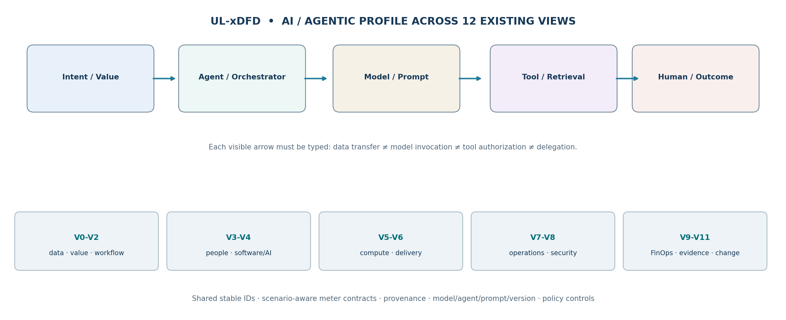

# Modeling guide

This guide describes how to create a useful UL-xDFD model without beginning with all 39 annotation families. The full catalog is available when a research question requires more precision.

## Decide what you want to compare

Write a decision question and at least one baseline scenario. Examples include sizing a private-cloud application, evaluating a CI/CD scan policy, assessing organizational readiness for DevSecOps, or comparing a model-based assistant with deterministic logic.

Pick an independently meaningful unit: a successful booking, a production deployment, a resolved ticket, or an accepted AI task. Counting requests alone can hide retries and failed attempts.

## Declare the boundaries and review team

Record included teams, infrastructure, providers, environments, cost periods, and data. Ask product owners, engineering, operations, security, finance, and affected representatives to review relevant parts. People evidence should be assessed respectfully, aggregated appropriately, and never inferred from graph topology.

## Build in layers

1. **Logical data:** create `X`, `P`, `S`, and `F` records, with distinct incoming and outgoing transfers.
2. **Traceability:** connect idea, value, requirement, component, pipeline, deployment, charges, and outcomes through typed edges.
3. **Workflow and ownership:** declare sequence/control events, approval predicates, responsible roles, failure paths, and time windows.
4. **Resources and AI:** add request distributions, demand, replicas, CPU/GPU needs, models, endpoints, RAG, tools, and metering.
5. **Evidence:** link calculations and observations to records, versions, sample windows, and reviewers.



## Keep annotations precise

Suppose a model endpoint has a hypothetical input-token value:

```yaml
id: AI-A01
target_id: MODELSVC1
key: aiinf.input_tokens_billed
value: 1500
datatype: number
unit: token/invocation
scope:
  scenario_id: SC-ai-booking
  phase_id: L09
  environment: simulation
  granularity: per_invocation
status: hypothetical
source_kind: simulation
evidence_refs: []
observed_at: '2026-11-15'
```

This is a **copy from the synthetic example**, not a published benchmark. Before replacing it with a real observation, use the provider's billing units or a measured record and attach provenance. Avoid exposing raw private prompt contents in a shared model.

## Model changes rather than rewriting history

When an API contract, model version, cost rate or authorization changes, create a new snapshot and preserve the prior version. A research baseline used for prediction must remain frozen so future outcomes cannot leak into it. Document whether a metric is proposed, measured before intervention, or measured afterward.

## Review before analysis

Apply structural checks, then semantic and evidence review. When critical load, price, or tool authorization is missing, report a bounded structural model but withhold the corresponding forecast or security claim. The current script implements only a small subset of the proposed rules. See [validation](validation.md).

[Back to README](../README.md)
