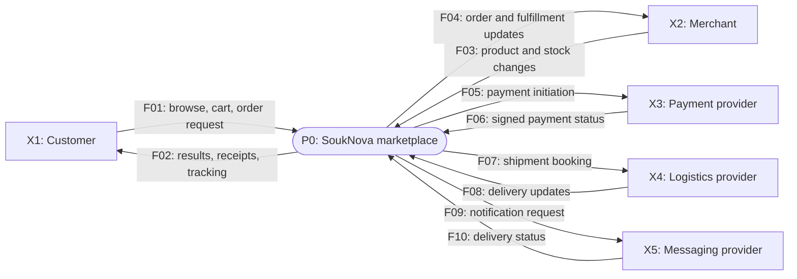
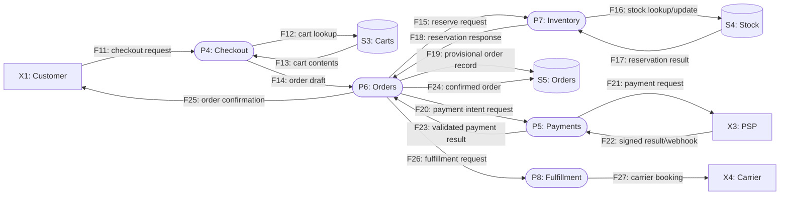
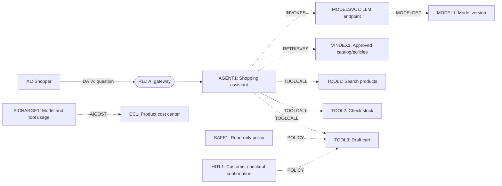
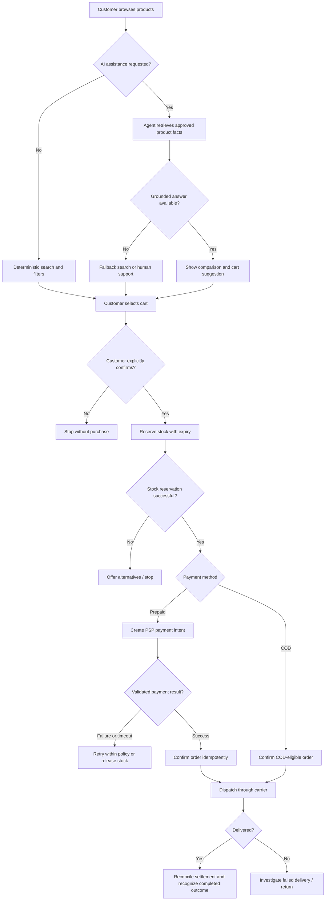
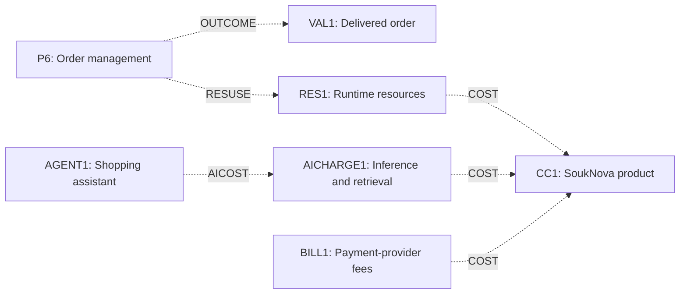

# SoukNova: modeling an AI-powered e-commerce startup with UL-xDFD

> **Worked example · UL-xDFD v1.0 · fictional Moroccan startup · documentation case study**


## Contents

1. [Why this case study](#1-why-this-case-study)
2. [The startup and its first release](#2-the-startup-and-its-first-release)
3. [How to read and build the UL-xDFD model](#3-how-to-read-and-build-the-ul-xdfd-model)
4. [L00 — Idea and opportunity](#l00-idea-and-opportunity)
5. [L01 — Discovery and feasibility](#l01-discovery-and-feasibility)
6. [L02 — Requirements and planning](#l02-requirements-and-planning)
7. [L03 — Architecture and design](#l03-architecture-and-design)
8. [L04 — Acquisition and sourcing](#l04-acquisition-and-sourcing)
9. [L05 — Build and implementation](#l05-build-and-implementation)
10. [L06 — Verification and validation](#l06-verification-and-validation)
11. [L07 — Integration and release](#l07-integration-and-release)
12. [L08 — Deployment and transition](#l08-deployment-and-transition)
13. [L09 — Operation and support](#l09-operation-and-support)
14. [L10 — Improvement and evolution](#l10-improvement-and-evolution)
15. [L11 — Retirement and disposal](#l11-retirement-and-disposal)
16. [The 12 UL-xDFD views of SoukNova](#16-the-12-ul-xdfd-views-of-souknova)
17. [A complete customer journey](#17-a-complete-customer-journey)
18. [Data, workloads, infrastructure and AI consumption](#18-data-workloads-infrastructure-and-ai-consumption)
19. [FinOps model with a worked monthly estimate](#19-finops-model-with-a-worked-monthly-estimate)
20. [Annotations and model serialization](#20-annotations-and-model-serialization)
21. [Validation, uncertainty and readiness](#21-validation-uncertainty-and-readiness)
22. [Expected modeling artifacts and next experiments](#22-expected-modeling-artifacts-and-next-experiments)
23. [References and related UL-xDFD documentation](#23-references-and-related-ul-xdfd-documentation)

---

## 1. Why this case study

Imagine a small team in Morocco planning an online marketplace. Its first challenge is getting products onto a website and accepting orders. Within a few months, the team may need to manage sellers, synchronize inventory, deal with delayed payments, resolve disputed deliveries and answer questions in Arabic and French. If it adds an AI shopping assistant, it must also account for model calls, retrieval indexes, tool permissions and the cost of unsuccessful agent sessions.

A conventional data flow diagram (DFD) helps the team describe where customer, product and order data move. It does not, by itself, tell the team how many orders will arrive, which API owns inventory reservations, what happens if a payment notification arrives twice, who can authorize a refund, or how an LLM conversation contributes to cloud spending.

**UL-xDFD** starts with the logical DFD and connects it to requirements, workflow, stakeholder responsibility, technical architecture, infrastructure, delivery, security, cost and evidence. The same identified elements are projected into **12 synchronized views**, then tracked through **12 lifecycle phases (L00–L11)**. In this example we use that structure to model the startup *before* it exists and to show what data would be collected when it eventually operates.

This walkthrough is useful for three kinds of work:

- **Architecture:** trace a purchase from customer request to confirmed delivery, including external services and AI assistance.
- **FinOps:** estimate resource demand, token usage and business-unit cost without confusing an estimate with an invoice.
- **Readiness and optimization research:** describe evidence required to assess DevOps/DevSecOps/MLOps capabilities, and define comparable alternatives for later experiments.

The model's terminology follows the [UL-xDFD v1.0 metamodel](../docs/technical/04-formal-metamodel.md), [element catalog](../docs/technical/05-elements-edges-notation.md), [annotation contract](../docs/technical/06-annotation-contract.md), and [lifecycle/view definitions](../docs/technical/03-lifecycle-views-stakeholders.md).

## 2. The startup and its first release

### 2.1 Business scenario

**SoukNova** is a hypothetical startup that wants to help small and medium Moroccan merchants sell online without running their own web shop. It plans a controlled pilot in **Casablanca and Rabat**, followed by a wider rollout only if seller operations, fulfillment and customer support prove manageable.

The platform includes a customer web/mobile storefront, a seller portal, an internal operations console, product and inventory services, cart and checkout, payment orchestration, delivery integration, returns, notifications and analytics. The AI component is deliberately narrower than the rest of the system: a **shopping assistant** that answers product and policy questions, compares products and prepares a cart proposal. It cannot autonomously charge a card, approve a refund or change a seller's inventory.

The startup will integrate with a suitable **authorized payment service provider** and logistics providers rather than becoming a payment processor or delivery operator itself. Provider contracts, financial settlement responsibilities and data-processing arrangements must be reviewed before launch.

### 2.2 Illustrative pilot assumptions

All values in this table are planning assumptions chosen to make the example reproducible; none is an observed Moroccan market statistic.

| Item | Hypothetical pilot assumption | Meaning |
| --- | ---: | --- |
| Sellers | 25 | Independently onboarded merchants |
| Active products | 5,000 SKUs | Catalog entries, not inventory units |
| Monthly shopping sessions | 80,000 | Sessions are not unique customers |
| Checkout attempts | 4,000/month | 5% of sessions attempt checkout |
| Accepted orders | 3,000/month | 75% of checkout attempts become accepted orders |
| Delivered orders | 2,850/month | 95% of accepted orders complete delivery |
| Average delivered order value | 260 MAD | Assumed average merchandise value |
| Platform commission | 12% | Applied to *delivered* merchandise value in this case |
| Prepaid share of accepted orders | 60% | Remaining orders use cash-on-delivery (COD) workflow |
| AI-assisted sessions | 20% | 16,000 sessions invoke the shopping assistant |
| Expected model calls per AI session | 1.35 | Includes planned additional calls/retries |
| Pilot accounting period | 30 days | All operating estimates use this period |

These assumptions define **SC-PILOT**. We also create scenarios for peak demand, provider failure, and growth; their values are not automatically proportional to SC-PILOT.

### 2.3 What is inside the system boundary?

**Inside SoukNova:** storefront APIs, seller management, catalog, cart, order orchestration, inventory reservation, payment coordination, delivery adapter, notification adapter, data stores, AI assistant gateway, observability, and CI/CD.

**Outside SoukNova:** customers, sellers, payment service provider, delivery companies, messaging provider, optional hosted LLM API, and human decisions made in external provider systems. A provider being “outside” does not remove SoukNova's responsibility to model its contracts, data exchanges or failures.

**Out of pilot scope:** SoukNova-owned warehouses, in-house card processing, a fully autonomous purchasing agent, cross-border fulfillment, and custom foundation-model training. These remain potential alternatives in V11, not implied current features.

## 3. How to read and build the UL-xDFD model

UL-xDFD has **two independent axes**. A **lifecycle phase** (`L00` through `L11`) tells us *when an activity or decision belongs in the product's life*. A **view** (`V0` through `V11`) tells us *which question we are answering*. A phase can include many views; a view can contain information from many phases.

Start with one **canonical, versioned model**. Every element has an enduring identifier. Then construct filtered diagrams for different concerns, without duplicating the meaning of the underlying entity. Numbers belong in typed annotations carrying scenario, unit, status, source and time context.

The following notation appears throughout:

| Notation | Interpretation | Example |
| --- | --- | --- |
| `X` | External entity | `X1` Customer |
| `P` | Logical process | `P6` Order management |
| `S` | Logical data store | `S5` Orders |
| `F` or `DATA` | **Data** transfer only | `F11` Checkout request |
| `WORK` | Ordering, trigger or retry | Payment verified **before** order confirmation |
| `OWN` | Ownership or accountability | Checkout team is responsible for `P5` |
| `HOST` / `RESUSE` | Deployment and resource usage | Checkout API uses compute pool `RES1` |
| `COST` / `AICOST` | Financial attribution | AI inference charge assigned to `CC1` |
| `POLICY` / `HITL` | Tool authorization and human gate | Agent cannot issue refund without approval |
| `EVID` / `OUTCOME` | Evidence and subsequently measured outcome | Load-test result; verified delivered-order count |

**Important:** A `DATA` arrow does **not** imply that its source executes before its destination. Ordering, decisions, concurrency, timeouts and compensation appear in `V2`, using separate `WORK` and `DEC` relationships.

A practical modeling workflow is: **define the idea → capture stakeholders and requirements → draw the logical DFD → map services and AI → annotate demand, constraints and costs → describe delivery and operations → add evidence → compare scenarios.**

---

## L00 — Idea and opportunity

**Story.** The founders meet merchants who currently receive orders through social-media messages and spreadsheets. They believe that a shared catalog and order-tracking platform could reduce manual reconciliation and make products easier to discover. At this point they do **not** know whether customers will purchase often enough or whether merchants will accept the commission.

**Create in UL-xDFD:**

1. `IDEA1` — “One marketplace for independent merchants.”
2. `VAL1` — “Successfully delivered marketplace order.” This is the primary unit of value, distinct from visits, checkouts and LLM responses.
3. `USE1` — Customer discovers and buys a product.
4. `USE2` — Merchant lists a product and fulfills an order.
5. `TEAM1` — Founding team; `ROLE1` — Product owner; `CC1` — SoukNova product cost center.
6. `REQ1` — Customers can browse products and place orders; `REQ2` — sellers manage availability; `REQ3` — protected payment and personal data.

Add `REQMAP` links between requirements and use cases; attach `OWN` links from the product owner to the idea and acceptance decisions. Record early transaction-volume and business-value assumptions as `hypothetical` annotations, not “observed demand.”

**Decision and evidence.** Interview a small, disclosed sample of sellers and customers, record dates and sampling limitations, and write a falsifiable business hypothesis. A suitable exit gate is agreement on the problem, first target users, intended value unit and acceptable pilot loss budget. No cost-optimization claim is justified yet.

**Primary views:** V1, V3, V10, V11.

## L01 — Discovery and feasibility

**Story.** The team interviews merchants about catalog updates, delivery handoffs and returned parcels. A seller might accept orders online but lack a real-time stock system. The team also learns that card payments and cash-on-delivery generate different settlement and reconciliation problems.

**Create in UL-xDFD:**

1. External entities: `X1` Customer, `X2` Seller, `X3` Payment provider, `X4` Logistics provider, `X5` Messaging provider and `X6` Support operator.
2. Sketch the context boundary `B1` “SoukNova marketplace.”
3. Define `USE3` — Delivery tracking and `USE4` — Return/refund request.
4. Record `CHG1` — “Hosted e-commerce platform vs custom modular application” as a design alternative, with assumptions and a decision owner.
5. Add `RISK1` — Seller inventory mismatch; `RISK2` — Settlement discrepancy; `RISK3` — Unapproved personal-data transfer to an AI provider.

**Feasibility checks.** Confirm merchant permission to sell, operational handling of returns, payment-provider merchant-of-record/settlement responsibilities, delivery service coverage, consumer disclosures, and privacy obligations. For Morocco, review **Law 09-08** and the **CNDP** formalities applicable to personal-data processing; assess cross-border transfers if customer data would reach hosted services abroad. Review **Law 31-08** and relevant distance-selling consumer information and protection requirements. This case study is not a legal determination; obtain local professional review for the actual operating model. See [CNDP site conformity](https://www.cndp.ma/conformite-des-sites-web/), [CNDP notification requirements](https://www.cndp.ma/notifier-un-traitement/), [CNDP cross-border data transfer guidance](https://www.cndp.ma/transfert-de-donnees-a-letranger/), and [consumer protection guidance](https://mcinet.gov.ma/en/content/consumer-protection-0).

**Decision and evidence.** Deliver a stakeholder map, a context-level DFD, a regulatory checklist, options register and an explicitly uncertain pilot budget. Reject or revise the design if the proposed payment, fulfillment or data-processing arrangements cannot be made acceptable.

**Primary views:** V0, V1, V3, V8, V10, V11.

## L02 — Requirements and planning

**Story.** The team moves from “build a marketplace” to acceptance criteria testable by engineers, sellers and support staff. Requirements explicitly separate technical service targets from hoped-for commercial outcomes.

**Create in UL-xDFD:**

| ID | Illustrative requirement or target | Planned verification |
| --- | --- | --- |
| `REQ4` | Customer can search by category, term and price | Automated acceptance tests |
| `REQ5` | Product availability cannot become negative through concurrent order acceptance | Concurrency and reconciliation tests |
| `REQ6` | Payment callbacks are authenticated and idempotent | Duplicate/reordered callback tests |
| `REQ7` | P95 catalog search latency **target** ≤ 500 ms at defined pilot peak | Controlled load test |
| `REQ8` | P95 internal checkout-processing latency **target** ≤ 1.2 s, excluding payment-provider redirect time | Traces and load test |
| `REQ9` | AI must not charge, cancel, refund or silently alter price/inventory | Policy and red-team tests |
| `REQ10` | Product and refund policy answers cite an approved source or fall back to human support | Evaluation suite |
| `REQ11` | Platform can reconcile prepaid and COD settlement records | Ledger reconciliation fixture |
| `REQ12` | Production service availability **objective** 99.9% over a defined measurement window | Monitoring after launch |

Set up scenario IDs: `SC-PILOT`, `SC-PEAK`, `SC-PAYMENT-FAILURE`, `SC-GROWTH`, and `SC-AI-PROVIDER-FAILURE`. Define which requirements are mandatory gates, which are aspirational, and who signs off. Plan accessibility, language support (Arabic/French), seller access boundaries, retention periods, and support escalation.

For AI, specify the unit of success (“verified helpful shopping-assistant session”), model-call cap, allowed tools, evaluation dataset, human fallback and maximum modeled spend. Do not describe a text response as a successful purchase.

**Decision and evidence.** Approve a scoped MVP backlog, initial budget envelope, risk register, test plan and delivery milestones. The founders retain a visible list of assumptions that cannot be confirmed before a pilot.

**Primary views:** V1, V2, V3, V8, V9, V10.

## L03 — Architecture and design

**Story.** The architect decomposes the business into logical responsibilities before selecting infrastructure. The team starts with a **modular application and separate background workers**, not an unnecessarily complex collection of independent microservices. Each module can later be extracted if measurements support it.

### L03.1 Level-0 context DFD (V0)

Only solid labeled arrows in this diagram mean **data transfer**. No arrow is intended to represent approval or execution order.



`P0` is a **context-level logical process**. The Level-1 decomposition maps it to finer-grained processes; the lower-level diagram must balance its external input/output contracts. The physical implementation may be a modular monolith, several services, or a hybrid. The DFD does not force that choice.

### L03.2 Logical process and data-store inventory

| ID | Process responsibility | Main data stores or exchanges |
| --- | --- | --- |
| `P1` | Identity and account management | `S1` Accounts; authentication and consent records |
| `P2` | Catalog administration and discovery | `S2` Products, media metadata |
| `P3` | Search and filters | `S2` Catalog and search index |
| `P4` | Cart and checkout request | `S3` Carts; price/stock confirmation |
| `P5` | Payment orchestration and reconciliation | `S6` Payment/settlement references; `X3` PSP |
| `P6` | Order management and state transition | `S5` Orders |
| `P7` | Inventory reservation | `S4` Inventory |
| `P8` | Fulfillment and carrier integration | `S7` Shipment records; `X4` carrier |
| `P9` | Notifications | `X5` provider; delivery logs |
| `P10` | Returns and refunds | `S5`, `S6`, `S7`; policy/approval checks |
| `P11` | AI shopping-assistant gateway | Agent runtime, model endpoint and policy tools |
| `P12` | Recommendation/ranking | Click/order-derived features and product ranking model |
| `P13` | Event analytics and cost attribution | `S8` Events, usage, and allocation records |
| `P14` | Seller onboarding and verification | Merchant records and approval state |

`S1` to `S8` are logical stores; they are not necessarily eight physical databases. A search index and vector index are different types of resource, even when implemented by one vendor.

### L03.3 Checkout DFD (V0, Level 1)



This diagram describes **what information moves**. The temporary hold, payment wait, callback replay, reservation expiry, rollback and retry behavior belong to the separate workflow model in V2. A customer choosing COD follows a distinct payment/collection branch; it is **not** treated as a completed online card transaction.

### L03.4 Technical deployment mapping (V4/V5)

Map `P1–P14` to `APP1` Storefront API, `APP2` Seller Portal, `APP3` Admin Console, `APP4` Background Workers and `APP5` AI Gateway. Use `API1` for checkout interfaces and `API2` for PSP callbacks. Define repositories, deployment units, secrets references, environments and runtime dependencies. Example: `DEP1 HOST RES1` maps the API deployment to its compute resource; `APP1 CODE P4` links implementation to the checkout process. These are not DATA edges.

**Decision and evidence.** Review data boundaries and technical alternatives. Produce the balanced logical DFD, initial architecture decision records, interface contracts, responsibility map, and preliminary capacity scenarios.

**Primary views:** V0, V2, V4, V5, V8.

## L04 — Acquisition and sourcing

**Story.** The team must select services it can support financially and contractually. The cheapest apparent hosting plan may not include backups, observability or traffic bursts. The least expensive LLM call may be unsuitable if data terms, latency or output quality do not meet the shopping-assistant requirements.

**Create in UL-xDFD:**

1. `CHG2` — Hosting options: managed application platform versus containers in a cloud account.
2. `CHG3` — Search options: managed full-text search, database search or dedicated index.
3. `CHG4` — AI options: search-only baseline, hosted LLM plus approved RAG, or self-hosted inference.
4. `RES1–RES8` — Planned compute, database, cache, media, network, monitoring and backup resources.
5. `MODEL1` and `MODELSVC1` — Chosen shopping-assistant model version and serving endpoint, kept separate.
6. `BILL1` — Payment-provider rate card; `AICHARGE1` — AI rate classes; `CC1` — product cost center.

Compare vendors on availability commitments, quotas, data location and processing terms, required support, currency, termination fees, export options and any committed minimum spend. Record **contracted or quoted prices with effective dates**. Until procurement evidence exists, prices are `hypothetical`, not `observed`.

**Decision and evidence.** Procurement sign-off includes supplier risk, privacy review, payment/cash-collection responsibility and an exit plan. Reserve provider names until contracted to avoid creating false implementation commitments.

**Primary views:** V3, V4, V5, V8, V9, V10, V11.

## L05 — Build and implementation

**Story.** The developers deliver a usable ordering flow first. An AI assistant is added only after catalog and policy data have a dependable source of truth; otherwise the assistant will confidently describe nonexistent stock or outdated return conditions.

**Create in UL-xDFD:**

- `REPO1` — Application source, configuration and infrastructure-as-code.
- `PIPE1` — CI pipeline; `PIPE2` — deployment pipeline.
- `ART1` — Versioned application artifact and dependency manifest.
- `APP1–APP5`, `API1–API2` and appropriate `CODE`, `DEL` and `CONTR` links.
- `CORPUS1` — Approved product/help/refund-policy documents.
- `VINDEX1` — Versioned vector/hybrid retrieval index.
- `PROMPT1` — Shopping-assistant prompt/guardrail version.
- `AGENT1` — Shopping assistant definition, with `TOOL1` ProductSearch, `TOOL2` StockLookup and `TOOL3` CartDraft.
- `SAFE1` — Read-only tool authorization; `HITL1` — Customer confirmation before checkout.
- `DATASET1` and `EVAL1` — Evaluation questions, acceptance rubric and reference judgments.

Implement transactional idempotency for payment callbacks and order confirmation. Use immutable order states, compensating reservation release on payment failure, outbox/event retry discipline, and reconciliation against settlement files. Keep raw card credentials and provider secrets out of application logs and AI prompts.

### AI integration detail

The assistant can retrieve approved product descriptions, compare items by documented attributes, and suggest a cart. A tool execution must be checked by application-side authorization, not by an LLM instruction alone.



The dotted links above are **typed non-DFD relationships**; any model prompt, retrieval query, tool result or AI response containing data also receives an explicit `DATA` record with classification, purpose and retention. `HITL1` governs the transition from a suggested cart to checkout; it does not imply the customer has already agreed or paid.

**Decision and evidence.** Each release candidate links commits, tests, review approvals, third-party component versions and prompt/model versions. Finished code without validated behavior is not a successful lifecycle outcome.

**Primary views:** V0, V4, V6, V8, V9, V10.

## L06 — Verification and validation

**Story.** Testing concentrates on failures that often appear only when asynchronous systems interact: two buyers ordering the last item, a callback arriving late, a seller changing price mid-checkout, or a carrier delivering the wrong parcel. AI testing is broader than “the response sounds natural.”

**Create in UL-xDFD:** `EVAL1` for AI tasks, `RISK1–RISK3` and relevant test assets, `EVID1+` for actual later test reports, and `OUT1+` for observed outcomes once there are measurements. Do not label an imagined test result as evidence.

| Test area | Example acceptance test | What gets recorded |
| --- | --- | --- |
| Checkout consistency | Concurrent reservations for final item | No negative available stock; reservation reconciliation |
| Payment callbacks | Duplicate, delayed, missing, forged and out-of-order events | Idempotent state transition; signed-callback rejection |
| COD reconciliation | Carrier reports partial/lost collection | Explicit outstanding balance and escalation |
| Search performance | SC-PILOT and SC-PEAK workloads | Real response-time distribution, throughput and error rate |
| Security | Authorization bypass, SSRF, injection, secrets exposure | Test/run version, severity, disposition |
| AI factuality | Questions about real products, stock and policy | Correct answers versus reference, citations, abstentions |
| Agent boundaries | Prompt injection attempts tool misuse or price change | Forbidden action blocked by policy enforcement |
| AI economics | Long prompts, loops, retries and provider errors | Tokens, model calls, tool calls, billable categories, failed tasks |
| Disaster recovery | Database restore and key dependency unavailability | RTO/RPO observations versus stated targets |

**AI evaluation rule:** Separate helpfulness, factual correctness, successful task resolution, safety violations, human escalation and commercial conversion. Run a deterministic search-only baseline alongside the LLM assistant. Use holdout product/policy questions and record evaluator disagreement.

**Decision and evidence.** Promotion requires passing mandatory security and payment gates, meeting declared performance targets under the tested workload, and showing a workable human fallback for AI failures. Any thresholds are decisions, not scientific proof of market success.

**Primary views:** V6, V7, V8, V9, V10.

## L07 — Integration and release

**Story.** The startup prepares its first controlled release. A source-code merge triggers a chain of build, quality checks, artifact creation, approval and staged rollout. The AI agent's prompt and tool policy are versioned alongside the code.

**Create in UL-xDFD:** `PIPE1` CI, `PIPE2` CD, `ART1` signed/versioned artifact, `ENV1` Staging, `ENV2` Production, `G1` Release approval gate, and relationships `DEL`, `WORK`, `DEC` and `OWN`. A `PIPE` element is not a substitute for a process in the logical DFD.

Illustrative release order: static checks → unit tests → dependency/secrets scans → integration tests → agent policy/evaluation tests → build and publish artifact → staging load tests → accountable approval → canary rollout → monitoring → full rollout or rollback.

Annotate pipeline duration, runner consumption, waiting time, scanner license cost, artifact provenance, release frequency and rollback procedure. Distinguish *mandatory* security gates from optional scans that may be scheduled or risk-adjusted.

**Decision and evidence.** A release manifest records code, infrastructure, database migration, model endpoint, prompt, corpus/index version and policy version. Promotion uses actual test reports, not the assumption that “CI is green” proves operational fitness.

**Primary views:** V2, V3, V6, V8, V9, V10, V11.

## L08 — Deployment and transition

**Story.** The team deploys in a small production environment and gradually enables sellers and customers. It must prepare for an unexpected marketing spike and a payment provider outage, even though the first weeks may be quiet.

**Create in UL-xDFD:** `ENV2` production, `DEP1` web/API, `DEP2` worker, `RES1` compute pool, `RES2` managed SQL, `RES3` cache/queue, `RES4` object storage/CDN, `RES5` metrics/logs, `RES6` backup, `RES7` search index, `RES8` AI retrieval index. Map processes to deployments using `CODE` and `HOST`, then attach `RESUSE` annotations for quantities and limits.

Use the planned deployment profile below as **requirements**, not verified sizing:

| Component | Initial provisioned approach | Scaling or resilience consideration |
| --- | --- | --- |
| Web/API | Two small application instances | Autoscaling on CPU, latency and queue depth; test under peak |
| Workers | One or more task workers | Queue age, retry budget, idempotency |
| SQL database | Managed primary with backups | Failover/restore test; capacity based on measured I/O |
| Cache | Small managed cache | TTL and cold-cache fallback |
| Media | Object storage + CDN | Image variants, egress, cache hit ratio |
| Search | Database/managed search index | Rebuild and eventual consistency |
| AI gateway | Separate bounded concurrency | Per-user quotas, rate limit, circuit breaker |
| Vector index | Small index for approved product/policy corpus | Versioned rebuild, content expiry, fallback search |

Maintain deployment diagrams, secret references, migration plans, data-retention policy, rollback route, alerts, and runbooks. The physical size of each resource remains an engineering hypothesis until controlled load tests and production measurement confirm it.

**Decision and evidence.** Release gradually. A pilot go/no-go decision is based on observed errors, delivery processing, reconciliation, AI guardrails and user support readiness, with a clear rollback trigger.

**Primary views:** V4, V5, V7, V8, V9, V10.

## L09 — Operation and support

**Story.** SoukNova receives real orders. The operations team now has to distinguish symptoms from causes: a failed purchase might be a customer cancellation, a stock conflict, a PSP rejection, a delivery constraint or an AI assistant that suggested the wrong product.

**Create in UL-xDFD:** dated `EVID` records linked to logs, traces, invoices, seller reconciliation, incident reports and AI evaluation samples; `OUT` records for measured delivered orders, error rates, customer outcomes and costs. Keep private raw customer data out of the shared research graph. Record observations with actual time windows, query definitions and sample sizes.

**Operational dashboard:**

- **Customer:** successful deliveries, checkout-to-order conversion, order cancellations and returns.
- **Reliability:** latency distribution, failed requests, availability, recovery duration and queue backlog.
- **Inventory:** reservation expiry, overselling incidents, seller feed freshness.
- **Payments:** accepted authorization, unmatched events, pending COD collections, refunds and net settlement.
- **AI:** invoked sessions, model calls per session, input/output/cached tokens, retrieval and tool calls, rate-limited sessions, unsafe action attempts, verified helpful responses and escalations.
- **FinOps:** project investment versus runtime spending, CI/CD spend, AI billed usage, payment/provider fees, allocated shared cost, actual versus forecast, and cost per **delivered** order.

For refunds or high-impact actions, the support agent reviews account ownership, policy, fraud indicators and the original payment. The shopping LLM may help retrieve a policy but must not independently authorize a transfer of funds.

**Decision and evidence.** Invoices and provider-billed tokens replace hypothetical estimates only for the windows they actually cover. Readiness remains a documented diagnostic assessment until independent organizational outcomes are observed and validated.

**Primary views:** V3, V7, V8, V9, V10.

## L10 — Improvement and evolution

**Story.** After operating for a while, the founders notice that some AI conversations repeatedly retrieve the same catalog information. They also find that payment fees matter more to unit economics than model tokens. Rather than optimizing an arbitrary metric, they compare alternative designs against business outcomes.

**Create in UL-xDFD:** `CHG5`–`CHG8` alternative configurations and linked evaluation plans:

| Proposed change | Hypothesis | Primary control / measurement |
| --- | --- | --- |
| Search-only fallback for simple product questions | Lower model spend while retaining adequate answers | Randomized or matched evaluation; verify correctness and escalation |
| Prompt/context reduction | Fewer billed input tokens without loss of facts | Token audit, grounded-answer quality and safety tests |
| More aggressive catalog/media cache | Lower egress and response time | Cache hit rate, staleness, origin load |
| Batched stock import | Lower processing overhead | Inventory freshness, reservation conflicts |
| Different deployment scale policy | Lower idle resource spend | Real peak latency, capacity reserve, failover |
| Safer agent tools | Fewer unauthorized action opportunities | Tool-policy violations and completed safe tasks |

An optimization should report **baseline versus intervention**, with the same demand scenario, delivered-order denominator, policy gates, experiment duration and uncertainty. A reduction in cost per LLM call is not necessarily a reduction in cost per successful customer outcome.

**Decision and evidence.** Publish versioned changes and results; revert any configuration that violates security, availability or verified AI quality constraints. Model every new release as an immutable change/snapshot relationship, not a fresh unrelated graph.

**Primary views:** V5, V6, V7, V8, V9, V10, V11.

## L11 — Retirement and disposal

**Story.** A product may be acquired, rebuilt or closed. Closing it safely is part of its lifecycle: the founders must still handle seller accounts, unsettled payments, customer rights, legal record retention and active external integrations.

**Create in UL-xDFD:** `CHG9` — Retirement plan; `RISK4` — Orphaned data/credentials; linked `PHASE`, `POLICY`, `COST` and `EVID` records. Add an end-of-service communication plan and a retention schedule reviewed against actual legal obligations.

The checklist includes disabling new orders, settling/refunding open obligations, exporting records required to remain available, archiving approved business evidence, revoking payment/carrier/API tokens, shutting down AI tools, removing indexes and secrets, and confirming provider deletion/contract exit where appropriate.

**Decision and evidence.** Produce signed decommissioning records, a costed termination scenario and verifiable completion of required actions. Deletion cannot be claimed merely because a node is removed from a diagram.

**Primary views:** V3, V8, V9, V10, V11.

---

## 16. The 12 UL-xDFD views of SoukNova

The previous sections follow the **lifecycle**. This section takes the **same canonical model** and examines it through each **view**. No element should be duplicated with an incompatible ID just because another stakeholder opens another diagram.

| View | Specific SoukNova artifact | Question answered |
| --- | --- | --- |
| **V0 — Logical data** | Context and checkout DFDs; product/order/payment flows; customer-data classifications | Where does the data move, and across which boundaries? |
| **V1 — Demand, value and requirements** | `IDEA1`, `VAL1`, `REQ1–REQ12`; delivered-order value and AI use-case requirements | What is the platform for, and what must it achieve? |
| **V2 — Workflow, events and time** | Order state machine, payment wait, COD route, timeout, retries, human approval | What must happen first, and which paths are conditional? |
| **V3 — People, organizations and governance** | Founder, product owner, seller operations, finance, engineers, AI risk reviewer, support | Who can decide, approve and respond? |
| **V4 — Software and technical architecture** | Storefront, seller portal, backend modules, APIs, workers, AI gateway and model endpoint | What implements each logical responsibility? |
| **V5 — Workloads, infrastructure and capacity** | Session rate, order throughput, object storage, API replicas, queues, model call volume | What resources might the demand require? |
| **V6 — Delivery, testing and DevSecOps** | CI/CD pipeline, security checks, test environments, model/prompt evaluation and release gate | Can software and AI changes be delivered safely? |
| **V7 — Operations, resilience and service management** | SLOs, callback replays, restore plans, incident procedures, AI rate limits | Can the platform keep working and recover? |
| **V8 — Security, privacy and compliance** | Trust boundaries, customer PII controls, PSP callback authentication, AI tool restrictions | What are the sensitive assets and necessary controls? |
| **V9 — FinOps, procurement and sustainability** | Compute, storage, AI tokens, payment fees, CI/CD, allocated shared costs and unit economics | What does the value stream consume and cost? |
| **V10 — Evidence, uncertainty and outcomes** | Assumption registry, benchmark results, invoice evidence, AI task evaluations, delivered-order records | Which claims are known, assumed or disputed? |
| **V11 — Lifecycle, decisions and change** | L00–L11 links, architecture decisions, cost-optimization variants and retired versions | How did design decisions and outcomes evolve? |

The [UL-xDFD view and lifecycle contract](../docs/technical/03-lifecycle-views-stakeholders.md) defines the semantics. The diagrams in this case study are readable projections, not the entire canonical graph rendered in one picture.

## 17. A complete customer journey

A shopper, **Amina**, wants a budget-friendly coffee machine. She sees a product, asks the AI assistant whether it supports a particular capsule type, compares two options, and accepts a proposed cart. She then decides to pay by card. The LLM has no authority to finish the purchase by itself.

### 17.1 Separate workflow from the DFD (V2)



This workflow highlights why a mere chain of data-flow arrows is insufficient. The PSP callback may arrive more than once; the same order must not be confirmed twice. COD collection is reconciled only after carrier events and settlement records. Retry and expiry times need explicit annotations.

### 17.2 Three traces for the same customer journey

| Trace | UL-xDFD relationships | Example |
| --- | --- | --- |
| Data | `DATA` | Customer question → `P11`; cart proposal → customer; payment status → `P5` |
| Control | `WORK`, `DEC`, `POLICY` | Approval before checkout; reserve-before-payment; verify callback before confirmation |
| Economic | `RESUSE`, `AICOST`, `COST`, `OUTCOME` | Agent calls billed to cost center; order revenue attributed only after defined delivery outcome |

These relationships can point to the same process but must remain separate records in the model.

## 18. Data, workloads, infrastructure and AI consumption

### 18.1 Baseline demand calculations

For `SC-PILOT`:

| Quantity | Hypothetical derivation | Result |
| --- | --- | ---: |
| Catalog API requests | 80,000 sessions × 8 requests/session | 640,000 requests/month |
| Search API requests | 80,000 × 2 requests/session | 160,000 requests/month |
| Cart mutations | 80,000 × 0.7 mutations/session | 56,000/month |
| Checkout attempts | 80,000 × 5% | 4,000/month |
| Accepted orders | 4,000 × 75% | 3,000/month |
| Delivered orders | 3,000 × 95% | 2,850/month |
| AI-assisted sessions | 80,000 × 20% | 16,000/month |
| Model invocations | 16,000 × 1.35 calls/session | 21,600/month |
| Retrieval requests | 16,000 × 0.75 queries/session | 12,000/month |

These are averages for a **30-day modeled month**. They do not establish a peak arrival process, a p95 latency, required replica count or customer-conversion rate under a campaign. Use request traces or controlled load generation to obtain peak and tail behavior.

### 18.2 Data and storage annotations

Assume each of the 5,000 products has four images averaging 200 KB each. Raw catalog image payload is approximately:

`5,000 products × 4 images/product × 200,000 bytes/image = 4.0 GB` (decimal, before variants, replication and backups).

If image variants and metadata add an illustrative **2.5× physical multiplier**, the working estimate becomes **10 GB** before backup copies. Treat this multiplier as an assumption to test against the chosen image pipeline. Similarly, assume **1.5 MB of CDN-served content per shopping session**, or **120 GB/month** of content delivery before cache/routing adjustments. These are separate quantities: stored media is not the same as billable external egress.

For `S5` order writes, an illustrative 8 KiB logical payload across 3,000 accepted orders is about **23.4 MiB** of raw event content per month; database indexes, version histories, audit logs, updates, replicas, backups and retention can be materially larger. Do not use raw payload bytes as the full managed-database capacity estimate.

Mark customer contact, addresses, purchases and support conversations as sensitive operational data under a project classification policy. Tokenized or masked context should reach `MODELSVC1` where possible; no raw payment-card data should pass through the shopping agent.

### 18.3 AI inference annotations

Assume an expected **1,400 billed input tokens** and **350 billed output tokens** per model invocation (the assumption includes the average effect of tool context). Under 21,600 invocations:

- **Input:** `21,600 × 1,400 = 30,240,000` tokens/month.
- **Output:** `21,600 × 350 = 7,560,000` tokens/month.

The arithmetic does **not** establish actual provider metering: cached-token classes, multimodal inputs, reasoning/internal output, retries and tokenizer behavior may differ by provider. The real model must store billable classes separately with provider usage records and versioned rate cards.

The agent has **a maximum of five steps per run** in the proposed policy; this is an upper limit, not the assumed average. Bound retries and tool calls; if the provider is unavailable, fall back to deterministic catalog search rather than making an unbounded series of paid calls. Track **attempted**, **completed**, **helpful** and **customer-confirmed** tasks separately.

### 18.4 Peak, failure and growth scenarios

| Scenario | What changes | Questions for UL-xDFD |
| --- | --- | --- |
| `SC-PILOT` | Assumptions above | Can the MVP meet the targets within budget? |
| `SC-PEAK` | Three-day promotion with significantly higher minute-level arrivals | Queue growth, cache hit rate, DB contention, provider quota, CDN egress |
| `SC-PAYMENT-FAILURE` | PSP callback delayed or unavailable | Does stock expire safely? Can orders reconcile after recovery? |
| `SC-AI-PROVIDER-FAILURE` | Hosted model reaches rate limit or returns invalid outputs | Does search-only fallback work? What tasks are lost? |
| `SC-GROWTH` | Fourfold monthly demand, new sellers and catalog updates | Are resources, seller support and cost allocation still viable? |

Do not obtain scenario costs by multiplying every SC-PILOT line item by the same factor. Fixed commitments, variable charges, discount tiers, burst headroom and merchant support costs behave differently. The modeling guide and equations are in [workload/capacity](../docs/technical/09-workload-and-capacity.md).

## 19. FinOps model with a worked monthly estimate

UL-xDFD separates **engineering investment**, **technology operations**, **CI/CD and security delivery**, **AI consumption**, and **business outcomes**. This section models a *monthly pilot operating scenario*; it does not include every expense required to run a company.

### 19.1 Hypothetical costs in MAD

Rates below are invented teaching inputs, **not current offers** from cloud, AI or Moroccan payment providers. A production forecast requires dated quotes, fee agreements and measured consumption.

| Category | Hypothetical monthly basis | Cost (MAD) |
| --- | --- | ---: |
| API/worker compute | Reserved/runtime estimate | 1,200.00 |
| Managed SQL | Database and basic availability allocation | 1,400.00 |
| Cache/queue | Provisioned estimate | 250.00 |
| Catalog media storage | Object storage and media pipeline | 350.00 |
| Network/CDN egress | Estimated delivery charge | 600.00 |
| Search/analytics | Index and analytics services | 450.00 |
| Application observability | Logs, metrics, traces | 400.00 |
| Backup/security infrastructure | Storage backups, protection allocation | 300.00 |
| **Cloud/platform subtotal** | | **4,950.00** |
| LLM input tokens | 30.24M tokens × 20 MAD/M tokens | 604.80 |
| LLM output tokens | 7.56M tokens × 80 MAD/M tokens | 604.80 |
| Vector index hosting | Fixed illustrative allocation | 260.00 |
| Retrieval queries | 12,000 × 0.004 MAD/query | 48.00 |
| Embedding refresh | 2M tokens × 6 MAD/M tokens | 12.00 |
| AI evaluations | Periodic test/evaluation allocation | 300.00 |
| AI-specific traces | Token/tool monitoring | 180.00 |
| **AI subtotal** | | **2,009.60** |
| CI/CD and security scans | Runner/scanner allocation | 300.00 |
| Card payment processing | 1,800 prepaid accepted orders × 260 MAD × 1.6%, plus 1 MAD each | 9,288.00 |
| Logistics integration | Integration service allocation, **not all delivery costs** | 500.00 |
| SMS/email notifications | Provider usage estimate | 600.00 |
| External customer support | Support service allocation | 1,200.00 |
| Refund/reconciliation overhead | Processing allocation | 250.00 |
| **Modeled monthly operating total** | | **19,097.60** |

**Cost accounting notes:** The 1.6% + 1 MAD payment formula is hypothetical and applies only to **prepaid accepted orders**, not the entire GMV or COD orders. Actual payment fees, taxes, reversal fees, COD collection charges, shipping subsidies, seller incentives, marketing and settlement models depend on contracts. If sellers or customers bear a fee, the model must identify the economic payer and avoid counting the amount again as platform expense. AI tracing is separate from general application observability to avoid charging the same meter twice.

### 19.2 Business unit economics

Using the defined **delivered-order** denominator:

- Delivered merchandise value: `2,850 × 260 = 741,000 MAD`.
- Hypothetical 12% platform commission on delivered value: `741,000 × 0.12 = 88,920 MAD`.
- Modeled operating cost per delivered order: `19,097.60 / 2,850 ≈ 6.70 MAD`.
- AI service cost per AI-assisted session: `2,009.60 / 16,000 ≈ 0.126 MAD`.
- LLM API-only cost per model invocation: `1,209.60 / 21,600 = 0.056 MAD`.

**Do not interpret `88,920 − 19,097.60` as net profit.** The estimate excludes founder and employee salaries, taxes, merchant acquisition, marketing, capital investment, undelivered-order losses, merchant payouts, some fulfillment costs and other liabilities. The total is a deliberately **partial operating cost envelope**.

### 19.3 End-to-end cost trace (V9)



The value relationship does not assert that the AI **caused** the delivery. Causal attribution would require a comparison or experiment; order-level cost allocation instead requires transaction and usage correlation IDs. See the [FinOps modeling specification](../docs/technical/10-cost-and-finops.md) and the [FinOps Framework](https://www.finops.org/framework/).

### 19.4 Investment cost is a separate model

Before launch, attach estimated person-hours to phases L01–L08 (product, design, development, test, security, legal review, rollout, AI evaluation), plus external contracts and tooling. Record hours, role rate, currency and uncertainty separately. A 6-month development budget must not be mixed into the 30-day operating total unless an explicit accounting and allocation policy says how the investment is recognized.

For later comparisons, use an agreed cost basis: **variable**, **marginal**, or **fully allocated** cost per delivered order. Each answers a different decision question.

## 20. Annotations and model serialization

An annotation is not simply a note beside a node. It is a typed record with a scope, status, unit and provenance. Below are **human-readable UL-xDFD annotation excerpts**; they illustrate the contract, not a complete importable project.

### 20.1 Workload assumption on an AI endpoint

```yaml
id: AN-AI-INPUT-001
target_id: MODELSVC1
key: aiinf.input_tokens_billed
value: 1400
datatype: number
unit: token/invocation
scope:
  scenario_id: SC-PILOT
  phase_id: L09
  environment: hypothetical-pilot
  window: illustrative-30-day-month
  granularity: per_model_invocation
status: hypothetical
source_kind: simulation
evidence_refs: []
observed_at: '2026-11-19'
uncertainty:
  kind: uncalibrated_assumption
  note: Replace with provider metering after pilot
```

### 20.2 Payment fee assumption

```yaml
id: AN-PAY-001
target_id: BILL1
key: fin.payment_processing_rate
value: 1.6
datatype: number
unit: percent/prepaid-accepted-order-value
scope:
  scenario_id: SC-PILOT
  phase_id: L09
  environment: hypothetical-pilot
  window: illustrative-30-day-month
status: hypothetical
source_kind: estimate
evidence_refs: []
observed_at: '2026-11-19'
assumptions:
  rate_basis: prepaid accepted-order GMV only
  fixed_fee: 1 MAD per prepaid accepted order
```

### 20.3 Missing information stays missing

```yaml
id: AN-AI-REGION-001
target_id: MODELSVC1
key: aiinf.data_processing_region
value: null
datatype: string
scope:
  scenario_id: SC-PILOT
  phase_id: L04
  environment: procurement
status: unknown
source_kind: estimate
evidence_refs: []
observed_at: '2026-11-19'
```

The missing region is a procurement and privacy review item; it must not silently inherit “Morocco” from the startup's office location. A `hypothetical` annotation does not turn into `observed` because a calculation is precise. A derived total should reference the input annotation IDs, calculation version, currency, valuation period and rule used. See the [annotation contract](../docs/technical/06-annotation-contract.md), [dictionary](../docs/technical/07-annotation-dictionary.md), and [serialization notes](../docs/technical/appendix-a-serialization.md).

### 20.4 Example object register

A tooling implementation can start with a table of IDs, then emit the canonical schema-supported YAML/JSON model:

| Object | ID | Core meaning | Key relationships |
| --- | --- | --- | --- |
| Business idea | `IDEA1` | Marketplace opportunity | `REQMAP` to requirements |
| Value measure | `VAL1` | Delivered order | `OUTCOME` from measured order results |
| Customer | `X1` | External buyer | `DATA` to storefront processes |
| Payment process | `P5` | Coordinates provider and reconciliation | `DATA` to/from `X3`; `OWN` to finance/engineering |
| Order store | `S5` | Order record and lifecycle | `DATA` to/from `P6` |
| AI agent | `AGENT1` | Shopping assistant | `INVOKES`, `TOOLCALL`, `RETRIEVES`, `POLICY` |
| Model service | `MODELSVC1` | Hosted inference | `MODELDEP` to version; cost metering |
| Retrieval index | `VINDEX1` | Approved product and policy context | `RETRIEVES`; provenance to `CORPUS1` |
| Human gate | `HITL1` | Explicit checkout confirmation | `POLICY` governing protected action |
| Cost center | `CC1` | Product allocation | `COST`, `AICOST` from charges |
| Outcome | `OUT1` | Delivered-order observations | `EVID` to signed reconciliation data |

Keep seller identities, personal addresses, prompt payloads, payment secrets and sensitive traces **outside** the published example. Use identifiers and sanitized, synthetic values. The reference schema and starter validator remain in [the reference JSON Schema](../schemas/ul-xdfd-ai-v1.schema.json) and [the starter validator](../tools/validate.py); do not imply a Markdown excerpt can be imported without first assembling and validating a complete project object.

## 21. Validation, uncertainty and readiness

### 21.1 What the model can be checked for today

The research starter kit includes structural validation facilities; the full set of UL-xDFD semantic rules is a **proposed specification**, not necessarily implemented software. Review the [validation rule catalog](../docs/technical/08-validation-rules.md) and [validation guidance](../docs/validation.md).

For SoukNova, inspect the following issues before publishing a reviewed model:

| Finding | Why it matters | Resolution |
| --- | --- | --- |
| Customer-to-store DATA arrow bypasses a process | Misstates conventional DFD semantics | Route via an identified process |
| No compensating action for failed payment after inventory reservation | May oversell or hold stock indefinitely | Explicit reservation expiry/release workflow |
| Agent can execute a payment/refund tool directly | Excessive agency and financial risk | Remove authority; require application-side authorization and HITL |
| AI model endpoint has no processing-region decision | Personal-data transfer risk remains unresolved | Procurement and privacy sign-off; data minimization |
| Cloud total includes both self-hosted GPU and API tokens for the same workload | Double-counting cost | Define mutually exclusive deployment/routing branches |
| Payment fee has no contract/effective date | Forecast can become stale | Attach dated source and sensitivity range |
| AI task “success” equals any produced answer | Inflates quality estimates | Use independent verified outcome and denominator |
| Readiness score based only on number of nodes | Architectural complexity is not organizational readiness | Collect evidence on actual delivery/ownership/culture practices |

### 21.2 DevOps/DevSecOps/AI readiness: diagnosis, not a prediction

Before launch, the team can assess **diagnostic gaps**:

- Does it have working version control, automated tests and reproducible builds?
- Are infrastructure changes and secrets governed?
- Do engineering, finance and support know who owns an incident or settlement mismatch?
- Can it trace a release to the software, configuration, prompts, model service and evaluation gate?
- Does it know what one delivered order and one verified AI task cost?
- Are AI policies enforced independently of the model output?
- Can the team measure change lead time, failures, recovery and support workload?

The answers must be supported by reviewable records or clearly marked interviews/estimates. Organizational culture cannot be inferred from diagram density. A **success probability** would require later observed outcomes, pre-specified measures, relevant comparison data and out-of-sample validation. Read [adoption and predictive limits](../docs/technical/11-adoption-and-prediction.md).

### 21.3 Comparison to demonstrate research value

To investigate whether UL-xDFD adds value, give independent teams the same SoukNova specification and compare:

| Baseline/variant | Task | Evaluation measure |
| --- | --- | --- |
| Conventional DFD only | Map customer/order information flows | Correct flows, missing business constraints, modeling time |
| UML/BPMN and architecture documents | Specify behavior and deployment | Coverage, contradictions across diagrams, reviewer agreement |
| Spreadsheet-based capacity and cloud estimate | Estimate demand and monthly cost | Traceability, scenario consistency and error against later actuals |
| UL-xDFD V0 + V2 + V4 | Model data, workflow and software architecture | Coverage and semantic defects |
| Full UL-xDFD with AI/FinOps/evidence | Model entire value stream | Constraint coverage, reproducibility, usability and burden |

These are **proposed experiments**, not published comparative results. Report annotation time, training overhead, unresolved issues and disagreements—not just the number of model fields. A useful notation should justify the effort required to maintain it.

## 22. Expected modeling artifacts and next experiments

At the end of this case study, the research team should be able to assemble the following outputs from one versioned canonical model:

| Output | Main view(s) | Completion condition |
| --- | --- | --- |
| Business/value specification | V1, V11 | Value unit, market assumptions and approval decisions recorded |
| Context and decomposed DFD | V0 | Typed flows, trust boundaries, balanced external contracts |
| Checkout and agent workflow | V2 | Retries, callbacks, human gates and compensation explicit |
| Stakeholder/RACI map | V3 | Critical activities have accountable owners |
| Software/AI architecture | V4 | Processes mapped to modules, APIs, models, indexes and tools |
| Infrastructure inventory | V5 | Resources linked to workload scenarios and constraints |
| CI/CD and AI evaluation pipeline | V6 | Build, test and promotion evidence recorded |
| Operations model | V7 | SLO definitions, traces, recovery and support paths |
| Privacy/threat model | V8 | Sensitive flows and agent authorization gates reviewed |
| Cost and unit-economics report | V9 | Exclusive categories, rates, currency, cost owner, business denominator |
| Evidence and uncertainty register | V10 | Assumptions, measurements and missing information distinguishable |
| Versioned decisions and alternatives | V11 | Architecture and optimization alternatives can be compared |

**Suggested practical exercises for the repository:**

1. **Architecture exercise:** Decompose `P0` into level-1 processes and check the parent/child external-flow balancing.
2. **Workload exercise:** Replace 80,000 sessions/month with a measured load-test profile and revise queue/database assumptions.
3. **AI FinOps exercise:** Compare deterministic product search, hosted RAG assistant and a different model route under the same task-quality threshold.
4. **Security exercise:** Inject an adversarial instruction in a product description and verify that `SAFE1` prevents unauthorized tools, regardless of model output.
5. **Research exercise:** Ask two groups to model the scenario with traditional DFDs and UL-xDFD, then measure errors, omissions, inter-rater agreement and effort.

A useful next repository addition would be a **fully schema-valid `examples/souknova.yaml`** created from this narrative and checked by the existing validator. The present Markdown file is intentionally a **human-readable case study**, not a claim that a complete runnable model or working startup has already been produced.

## 23. References and related UL-xDFD documentation

### UL-xDFD repository references

- [UL-xDFD overview](../README.md)
- [Lifecycle, 12 synchronized views and stakeholders](../docs/technical/03-lifecycle-views-stakeholders.md)
- [Formal metamodel](../docs/technical/04-formal-metamodel.md)
- [Elements, typed relationships and notation](../docs/technical/05-elements-edges-notation.md)
- [Universal annotation contract and evidence statuses](../docs/technical/06-annotation-contract.md)
- [Annotation dictionary](../docs/technical/07-annotation-dictionary.md)
- [Validation rules](../docs/technical/08-validation-rules.md)
- [Workload and capacity](../docs/technical/09-workload-and-capacity.md)
- [Project, cloud, AI and FinOps costs](../docs/technical/10-cost-and-finops.md)
- [Adoption/readiness and prediction research boundaries](../docs/technical/11-adoption-and-prediction.md)
- [Architecture and tool implementation](../docs/technical/14-tool-architecture.md)
- [Scientific validation protocol](../docs/technical/16-research-validation.md)

### External background references

- [FinOps Foundation — Framework](https://www.finops.org/framework/). Inform, Optimize and Operate are iterative FinOps practices; they are not substitutes for UL-xDFD's lifecycle phases.
- [Morocco CNDP — Conformité des sites web](https://www.cndp.ma/conformite-des-sites-web/). Official guidance for website personal-data processing.
- [Morocco CNDP — Notifier un traitement](https://www.cndp.ma/notifier-un-traitement/). Official notification/authorization guidance; applicability requires project-specific review.
- [Morocco CNDP — Transfert de données à l'étranger](https://www.cndp.ma/transfert-de-donnees-a-letranger/). Guidance relevant to external cloud and AI service processing.
- [Moroccan Ministry of Industry and Trade — Consumer protection](https://mcinet.gov.ma/en/content/consumer-protection-0). Consumer protection and distance-selling context under Law 31-08.

---

**How to use this example:** Add this file as `examples/ai-powered-ecommerce-ul-xdfd.md` and add a link to it in the repository's root `README.md` under its examples section.

**Research and operational boundary:** SoukNova is fictional. Its volumes, architectures, prices, staffing choices and success measures are scenario inputs for teaching and model evaluation. None should be presented as verified production results, vendor quotes, legal clearance or proof that UL-xDFD improves outcomes.
