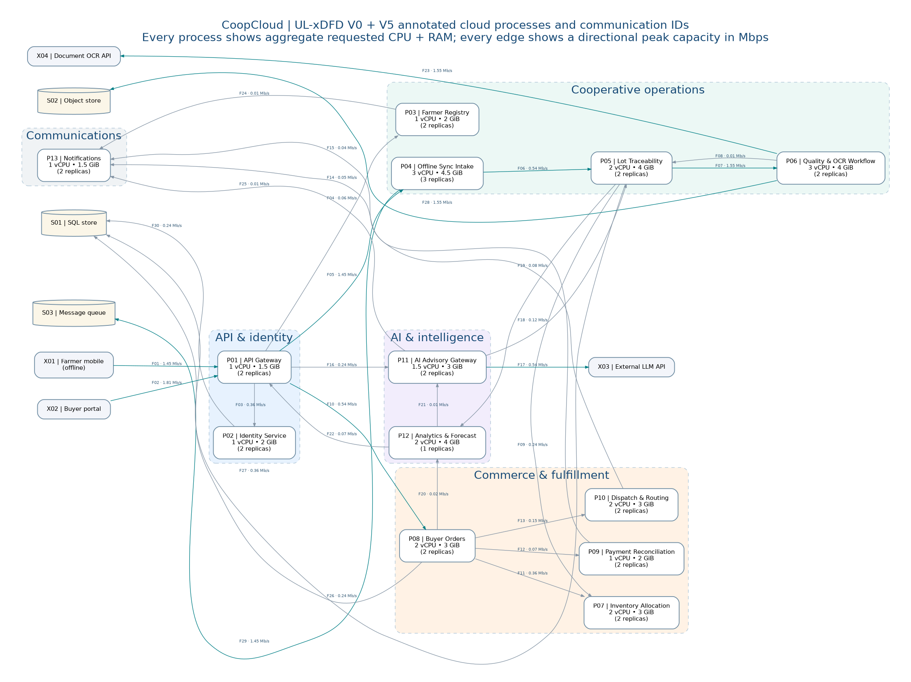
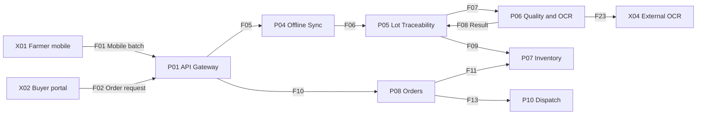
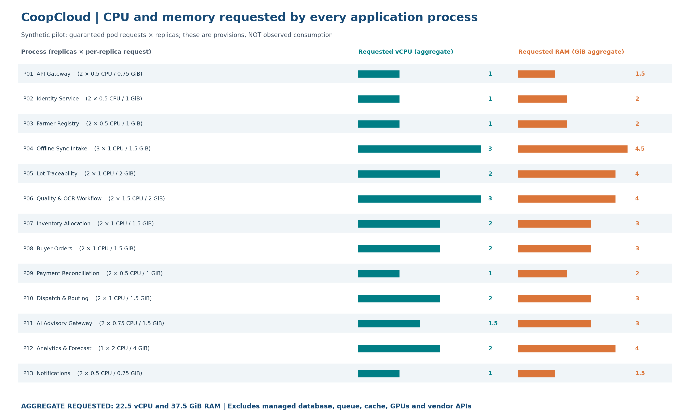
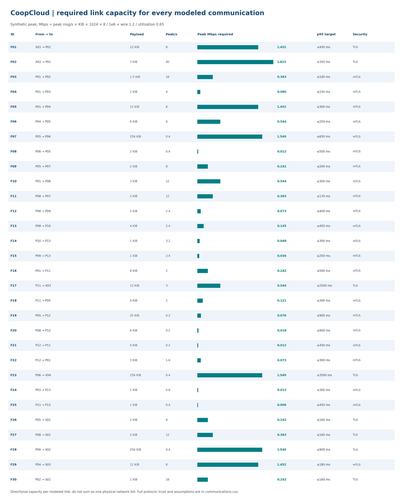
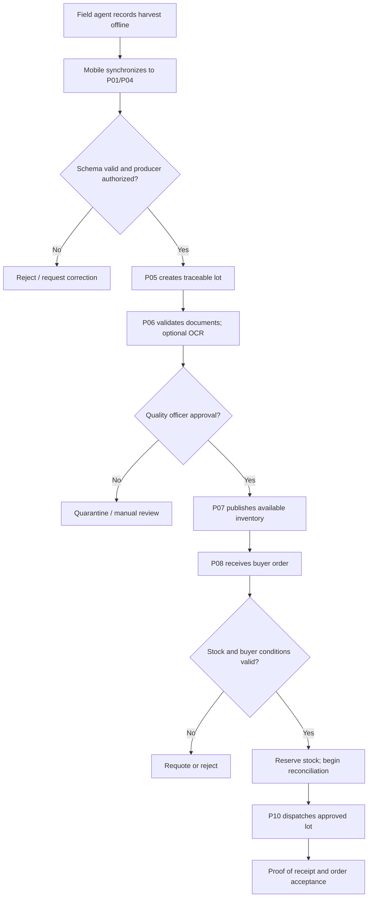
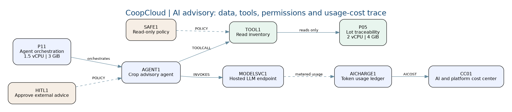
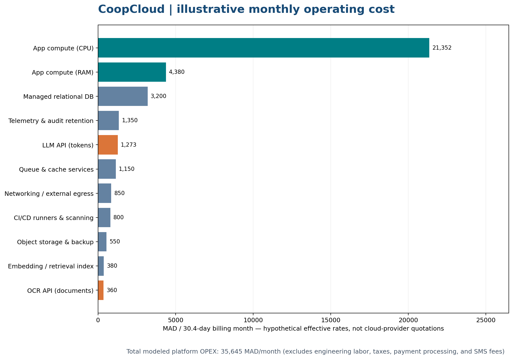

# CoopCloud: a cloud-consumption UL-xDFD example for digitizing Moroccan agricultural cooperatives

> **Scenario:** A fictional Moroccan startup wants to replace paper-based agricultural cooperative records with an offline-first traceability and market-access platform. The example shows how UL-xDFD records the *data flow*, the *resource requirements* of every processing service, the *communication requirements* of every connection, and the *FinOps consequences* of the proposed deployment.


## Contents

1. [The business problem and the startup](#1-the-business-problem-and-the-startup)
2. [What this example demonstrates](#2-what-this-example-demonstrates)
3. [UL-xDFD system boundary and graph](#3-ul-xdfd-system-boundary-and-graph)
4. [Full CPU and RAM allocation for every process](#4-full-cpu-and-ram-allocation-for-every-process)
5. [Communication contracts for every data flow](#5-communication-contracts-for-every-data-flow)
6. [The business journey and workflow](#6-the-business-journey-and-workflow)
7. [Lifecycle walkthrough: L00–L11](#7-lifecycle-walkthrough-l00l11)
8. [All 12 UL-xDFD views](#8-all-12-ul-xdfd-views)
9. [AI agent, OCR and model-consumption details](#9-ai-agent-ocr-and-model-consumption-details)
10. [Capacity calculations and stress scenarios](#10-capacity-calculations-and-stress-scenarios)
11. [FinOps: monthly cloud and AI cost model](#11-finops-monthly-cloud-and-ai-cost-model)
12. [Optimization experiments](#12-optimization-experiments)
13. [Annotations, serialization and validation](#13-annotations-serialization-and-validation)
14. [Limitations and references](#15-limitations-and-references)

## 1. The business problem and the startup

Consider a cluster of small agricultural cooperatives in the Souss-Massa region of Morocco. Each cooperative works with farmers, collection facilities, quality inspectors, buyers and carriers. Production records are captured on paper or spreadsheets. Quality documents arrive as photos; buyers receive stock updates over messaging apps; tracing a particular product lot back to its producer is slow. Connectivity in agricultural areas may be intermittent.

The fictional startup **CoopCloud** proposes a platform for digitizing this value chain. Farmers use a phone to register harvest lots even when offline; data synchronizes later. Quality officers review certificates, inventory becomes visible to approved buyers, orders are matched to lots, delivery events are recorded, and financial staff reconcile payments. A limited AI assistant helps staff find records and explain documented procedures, subject to clear permissions and human approval for consequential advice.

The initial pilot assumes 8 cooperatives, approximately 350 active farmers, 65 buyers and 30 days of operation. These counts are invented to make capacity planning concrete. No real cooperative, agency or transport provider is represented.

The main business unit is an **accepted, completed order**. Supporting units include a validated harvest lot, a document examined and a successfully completed advisory request. Keeping these denominators separate matters: one order may touch several lots and dozens of API calls.

### Stakeholders and boundaries

| Stakeholder | Responsibility | Evidence they should sign off |
|---|---|---|
| Farmer and field agent | Capture accurate lot quantities, photos and farm metadata | Tested offline intake and correction workflow |
| Cooperative manager | Accept membership and lot classification rules | Approval policy and documented ownership |
| Quality officer | Inspect certificates and approve or reject quality findings | Manual review records and sampling protocol |
| Buyer / procurement office | Place orders and accept delivery terms | Order acceptance records and service requirements |
| Logistics partner | Collect and deliver approved lots | Event schema and operational responsibilities |
| Finance and compliance team | Reconcile transfers and data-handling obligations | Rate card, invoices, retention policy, contracts |
| Platform, QA, DevSecOps, SRE | Implement, secure, deploy and measure the system | Test results, traces, security review and recovery drill |
| AI/product governance owner | Restrict advisory automation and evaluate task quality | Model version, usage records, evaluation and human-review decisions |

External LLM and OCR providers are outside the startup's logical processing boundary. They appear as distinct external entities. The SQL database, object store and message queue are stores; their provider-managed technology cost is recorded separately from the CPU/RAM of application services.

## 2. What this example demonstrates

A conventional DFD can show that a farmer submits lot data and that an inventory service consumes it. It cannot, by itself, tell an architect whether the intake service needs one or three replicas, how many Mbit/s a photo transfer requires, who pays for a model invocation, or who must approve an AI-generated recommendation.

For CoopCloud, UL-xDFD keeps all of this in one canonical model while separating relationship semantics:

- `DATA` edges describe information transfer, never execution order by implication.
- `WORK`, `DEC` and `POLICY` edges express precedence, approval and controls.
- `RESUSE`, `HOST`, `COST`, `AICOST` and `OWN` edges link services to infrastructure, budgets and responsible teams.
- Per-element annotations state units, scope, source and evidence status, so a calculated figure can be audited later.

The sample includes **13 application processes**, **30 directional data-flow contracts**, **34 model nodes**, and additional non-data relationships, with every numeric quantity classified as hypothetical. The accompanying canonical YAML/JSON files provide a machine-readable version.

## 3. UL-xDFD system boundary and graph

### 3.1 Architecture diagram with process resources and communication IDs



**Figure 1.** UL-xDFD V0 (logical data) projected together with V5 (resource requirements). Each processing node shows its **aggregate CPU and RAM requests across replicas**. Each directional communication edge shows `Fxx` and its required peak link capacity in Mbit/s. The full per-flow latency, protection, rate and payload requirements appear in Figure 3 and Table 2. [Open the vector version](coopcloud-cloud-consumption/assets/fig01_cloud_annotated_architecture.svg).

When the full graph becomes visually dense, readers should use the process resource figure, the communication figure and the detailed tables rather than assuming edge crossings represent logical merges or an execution sequence. One node can appear in several stakeholder views while keeping the same model ID.

### 3.2 Core element register

| IDs | Role in the model | Boundary |
|---|---|---|
| `X01`, `X02` | Farmer mobile client and buyer portal | External application clients |
| `P01`–`P13` | Operational and AI-adjacent application processes | Startup application deployment |
| `S01`, `S02`, `S03` | Relational store, encrypted object store and durable queue | Managed resources |
| `X03`, `X04` | Hosted LLM and OCR vendors | External vendors; trust transfer must be reviewed |
| `AGENT01`, `MODELSVC01`, `MODEL01` | Agent, model serving and versioned model binding | UL-xDFD AI overlay |
| `SAFE01`, `HITL01`, `TOOL01` | Safety policy, human gate, read-only lot lookup tool | Governance and AI control |
| `RES01`, `CC01`, `AICHARGE01` | App compute resource pool, cost center and metered AI charges | V5/V9 resource and cost projections |

### 3.3 Compact logical DFD example



This Mermaid graph is deliberately simplified. The downloadable Figure 1 and `communications.csv` provide the full 30-edge model, including database, notification and AI-service transfers.

## 4. Full CPU and RAM allocation for every process

### 4.1 Resource figure



**Figure 2.** Every application process and its *proposed resource reservation*. Read `3 × 1 vCPU / 1.5 GiB` as three replicas, each requesting 1 vCPU and 1.5 GiB RAM. These are capacity-planning inputs, **not measured CPU utilization, real memory use, or machine-size recommendations**. [SVG version](coopcloud-cloud-consumption/assets/fig02_cpu_ram_per_process.svg).

### 4.2 Resource register — V5

| Process | Responsibility | Replicas | CPU / replica | RAM / replica | Total CPU | Total RAM |
|---|---|---:|---:|---:|---:|---:|
| `P01` | API Gateway | 2 | 0.5 vCPU | 0.75 GiB | 1 vCPU | 1.5 GiB |
| `P02` | Identity Service | 2 | 0.5 vCPU | 1 GiB | 1 vCPU | 2 GiB |
| `P03` | Farmer Registry | 2 | 0.5 vCPU | 1 GiB | 1 vCPU | 2 GiB |
| `P04` | Offline Sync Intake | 3 | 1 vCPU | 1.5 GiB | 3 vCPU | 4.5 GiB |
| `P05` | Lot Traceability | 2 | 1 vCPU | 2 GiB | 2 vCPU | 4 GiB |
| `P06` | Quality & OCR Workflow | 2 | 1.5 vCPU | 2 GiB | 3 vCPU | 4 GiB |
| `P07` | Inventory Allocation | 2 | 1 vCPU | 1.5 GiB | 2 vCPU | 3 GiB |
| `P08` | Buyer Orders | 2 | 1 vCPU | 1.5 GiB | 2 vCPU | 3 GiB |
| `P09` | Payment Reconciliation | 2 | 0.5 vCPU | 1 GiB | 1 vCPU | 2 GiB |
| `P10` | Dispatch & Routing | 2 | 1 vCPU | 1.5 GiB | 2 vCPU | 3 GiB |
| `P11` | AI Advisory Gateway | 2 | 0.75 vCPU | 1.5 GiB | 1.5 vCPU | 3 GiB |
| `P12` | Analytics & Forecast | 1 | 2 vCPU | 4 GiB | 2 vCPU | 4 GiB |
| `P13` | Notifications | 2 | 0.5 vCPU | 0.75 GiB | 1 vCPU | 1.5 GiB |
| **Total** | **Application containers only** | | | | **22.5 vCPU** | **37.5 GiB** |


`Total requested vCPU = sum(replicas × requested vCPU per replica) = 22.5 vCPU`.

`Total requested RAM = sum(replicas × requested GiB per replica) = 37.5 GiB`.

These are *application workload requests* before node packing, scheduler reserve, operating-system overhead, spare capacity, failover margin and autoscaling. A Kubernetes request is also not the same as its CPU limit or guaranteed delivery of application throughput.

**Important architectural distinction:** `P06` is a CPU-based document-validation/orchestration service. OCR inference happens at external entity `X04`. `P11` orchestrates an external hosted LLM; its 1.5 vCPU and 3 GiB **do not include the provider's GPU consumption**. `P12` is a CPU-based analytics/forecast service; its hypothetical batch workload does not justify inventing a GPU. If self-hosted model serving is selected later, add a separate accelerator resource and GPU-hour cost.

### 4.3 Infra resources omitted from Figure 2

In addition to these 13 app services, the scenario includes a managed relational database (`S01`), object store (`S02`), queue (`S03`), cache, telemetry, backup, ingress and CI/CD services. They have separate billing allocations in V9. A managed service's provider CPU/RAM should not automatically be added to app-pod totals unless that capacity is explicitly reserved and known.

## 5. Communication contracts for every data flow

### 5.1 Full communication requirements figure



**Figure 3.** All 30 directed communications, each with a directional peak requirement in **Mbit/s**, a p95 hop-latency target, payload size, peak message rate and transport protection. [SVG version](coopcloud-cloud-consumption/assets/fig03_communication_requirements.svg).

### 5.2 Exact analytical convention

For flow `f`, the scenario's provisioned link-capacity estimate is:

\[
B_{f,required} = \frac{\lambda_{f,peak} \times s_f \times 1024 \times 8}{10^6} \times \frac{k_{wire}}{u_{target}} \quad \text{Mbit/s}
\]

where `s_f` is in **KiB/message**, `λ_peak` is in **messages/second**, the hypothetical wire/protocol factor is **1.20**, and the assumed link utilization ceiling is **0.65**. This is a first-order sizing heuristic; retransmissions, encryption overhead, bursts, shared paths, compression and transport behavior require testing. The diagram values are not guaranteed physical-port capacities.

For `F02` (buyer portal → API gateway), the hypothetical peak is 40 requests/s at 3 KiB each:

- Raw payload: `40 × 3 × 1024 × 8 / 1,000,000 = 0.983 Mbit/s`.
- With 20% wire overhead and 65% target utilization: `0.983 × 1.20 / 0.65 = 1.815 Mbit/s` (rounded).
- Its p95 hop latency is a **design target of ≤350 ms**, not a measured observation.

For `F07` (lot service → QA workflow), image/document transfer produces about **1.549 Mbit/s** at only 0.4 messages/s because the mean payload is 256 KiB. Low event rate therefore does not always imply negligible network demand.

### 5.3 Complete edge contract table — V0/V5/V7/V8

| Flow | Source → destination | Mean payload | Normal msg/s | Peak msg/s | Required peak Mbps | p95 hop target | Protocol / protection |
|---|---|---:|---:|---:|---:|---:|---|
| `F01` | `X01` → `P01` | 12 KiB | 2 | 8 | 1.452 | ≤ 450 ms | HTTPS / TLS |
| `F02` | `X02` → `P01` | 3 KiB | 10 | 40 | 1.815 | ≤ 350 ms | HTTPS / TLS |
| `F03` | `P01` → `P02` | 1.5 KiB | 4 | 16 | 0.363 | ≤ 100 ms | gRPC / mTLS |
| `F04` | `P01` → `P03` | 1 KiB | 1 | 4 | 0.060 | ≤ 150 ms | HTTPS / mTLS |
| `F05` | `P01` → `P04` | 12 KiB | 2 | 8 | 1.452 | ≤ 300 ms | HTTPS / mTLS |
| `F06` | `P04` → `P05` | 6 KiB | 1.5 | 6 | 0.544 | ≤ 250 ms | AMQP / mTLS |
| `F07` | `P05` → `P06` | 256 KiB | 0.1 | 0.4 | 1.549 | ≤ 650 ms | HTTPS / mTLS |
| `F08` | `P06` → `P05` | 2 KiB | 0.1 | 0.4 | 0.012 | ≤ 500 ms | AMQP / mTLS |
| `F09` | `P05` → `P07` | 2 KiB | 2 | 8 | 0.242 | ≤ 200 ms | AMQP / mTLS |
| `F10` | `P01` → `P08` | 3 KiB | 3 | 12 | 0.544 | ≤ 300 ms | HTTPS / mTLS |
| `F11` | `P08` → `P07` | 2 KiB | 3 | 12 | 0.363 | ≤ 170 ms | gRPC / mTLS |
| `F12` | `P08` → `P09` | 2 KiB | 0.6 | 2.4 | 0.073 | ≤ 400 ms | AMQP / mTLS |
| `F13` | `P08` → `P10` | 4 KiB | 0.6 | 2.4 | 0.145 | ≤ 450 ms | AMQP / mTLS |
| `F14` | `P10` → `P13` | 1 KiB | 0.8 | 3.2 | 0.048 | ≤ 300 ms | AMQP / mTLS |
| `F15` | `P09` → `P13` | 1 KiB | 0.6 | 2.4 | 0.036 | ≤ 250 ms | AMQP / mTLS |
| `F16` | `P01` → `P11` | 8 KiB | 0.5 | 2 | 0.242 | ≤ 500 ms | HTTPS / mTLS |
| `F17` | `P11` → `X03` | 12 KiB | 0.75 | 3 | 0.544 | ≤ 2500 ms | HTTPS / TLS |
| `F18` | `P11` → `P05` | 4 KiB | 0.5 | 2 | 0.121 | ≤ 300 ms | gRPC / mTLS |
| `F19` | `P05` → `P12` | 25 KiB | 0.05 | 0.2 | 0.076 | ≤ 900 ms | AMQP / mTLS |
| `F20` | `P08` → `P12` | 6 KiB | 0.05 | 0.2 | 0.018 | ≤ 900 ms | AMQP / mTLS |
| `F21` | `P12` → `P11` | 4 KiB | 0.05 | 0.2 | 0.012 | ≤ 450 ms | gRPC / mTLS |
| `F22` | `P12` → `P01` | 3 KiB | 0.4 | 1.6 | 0.073 | ≤ 300 ms | HTTPS / mTLS |
| `F23` | `P06` → `X04` | 256 KiB | 0.1 | 0.4 | 1.549 | ≤ 3500 ms | HTTPS / TLS |
| `F24` | `P03` → `P13` | 1 KiB | 0.2 | 0.8 | 0.012 | ≤ 300 ms | AMQP / mTLS |
| `F25` | `P11` → `P13` | 1 KiB | 0.1 | 0.4 | 0.006 | ≤ 450 ms | AMQP / mTLS |
| `F26` | `P05` → `S01` | 2 KiB | 2 | 8 | 0.242 | ≤ 160 ms | SQL / TLS |
| `F27` | `P08` → `S01` | 2 KiB | 3 | 12 | 0.363 | ≤ 160 ms | SQL / TLS |
| `F28` | `P06` → `S02` | 256 KiB | 0.1 | 0.4 | 1.549 | ≤ 900 ms | HTTPS / TLS |
| `F29` | `P04` → `S03` | 12 KiB | 2 | 8 | 1.452 | ≤ 180 ms | AMQP / mTLS |
| `F30` | `P02` → `S01` | 1 KiB | 4 | 16 | 0.242 | ≤ 160 ms | SQL / TLS |


The full [machine-readable flow table](coopcloud-cloud-consumption/data/communications.csv) adds short business meanings. The [source assumptions](coopcloud-cloud-consumption/data/assumptions.json) and [YAML model](coopcloud-cloud-consumption/model/coopcloud-ul-xdfd.yaml) retain the same identifiers.

**Avoid three common mistakes:** (1) Do not sum 30 directional capacities and call the result the ISP link or the cloud bill: some flows share paths, some run in different locations and some are internal. (2) Do not add individual p95 hop latencies to assert an end-to-end p95. (3) Do not equate a link-capacity reservation with billable network egress in GB; that requires direction, actual transferred bytes, price tiers and provider-specific rules.

## 6. The business journey and workflow

Consider one farmer registering a harvest lot and a buyer later ordering part of it. UL-xDFD tracks a normal, traceable workflow while separately recording which data moves between services.



**Workflow arrows are not DFD data arrows.** In a complete UL-xDFD project, model this with `EV`, `G`, `WORK` and `DEC` entities/relations in V2. The data in `F05`, `F06`, `F07`, `F09`, `F10` and `F11` remains in V0; the actors who approve quality and credit are in V3 and V8. The AI assistant must never silently bypass the quality gate.

### Failure paths and backpressure

If mobile data arrive after hours offline, `P04` should deduplicate by immutable client event ID, enqueue accepted records, acknowledge receipt separately from final validation and bound retry loops. On OCR failure, retain the uploaded original and route the certificate to manual QA. On financial mismatch, `P09` creates a reconciliation exception; there is no automatic proof that payment was collected merely because an order exists.

## 7. Lifecycle walkthrough: L00–L11

### L00 — Idea and opportunity

The startup identifies duplicate paperwork, poor traceability and delayed buyer confirmation. It records `IDEA` and `VAL` objects such as *accepted orders per month*, *fraction of lots with verified provenance* and *time needed to retrieve quality documents*. Stakeholders state which problems require technology and which require new governance. **Output:** business hypothesis, value denominator, sponsor and preliminary cost ceiling.

### L01 — Discovery and feasibility

Researchers interview a producer, cooperative manager, quality officer, buyer, platform engineer and finance representative. They map the manual document path and locations with unreliable connectivity. AI OCR is compared with ordinary manual indexing and fixed document templates; the advisory agent is compared with searchable help pages. **Output:** context DFD, trust boundary, feasible options, unresolved legal and provider conditions.

### L02 — Requirements and planning

The team defines requirement IDs for offline conflict resolution, producer authorization, lot lineage, stock reservation, multilingual interfaces, settlement reconciliation and human review. It proposes per-hop p95 latency targets and network capacity as in Table 2, without claiming a full end-to-end SLO. The FinOps owner requires an allocated monthly budget and a cost-per-accepted-order reporting rule. **Output:** traceable requirements, acceptance tests, scenario definitions and annotation owners.

### L03 — Architecture and design

The architect creates the 13-process canonical V0 graph and maps it to V4/V5. Logical `S01` is a relational store; `S02` retains encrypted images; `S03` handles temporary workload buffering. `P04` and `P06` have intentionally distinct responsibilities. The full process and flow registries are recorded in the Figures 1–3 and the YAML project. **Output:** signed graph baseline, link contracts, CPU/RAM assumptions, trust review and dependencies.

### L04 — Acquisition and sourcing

Procurement compares infrastructure contracts and external model/OCR providers. They request actual billing units, data processing terms, residency options, service quotas, support commitments and exit costs. Rate cards in this example are placeholders; the procurement gate cannot be marked complete on the strength of this fictional cost model. **Output:** proposed vendors, evidence requirements and an unapproved forecast.

### L05 — Build and implementation

A small team implements offline event IDs, schema validation, tenant-scoped service calls, event-driven inventory updates and versioned API contracts. The QA workflow stores the original attachment before attempting OCR. AI tools expose read-only lot summaries, not direct payment or inventory write operations. **Output:** repositories, code ownership, integration tests, trace correlation IDs and durable audit records.

### L06 — Verification and validation

Run normal and 4× traffic profiles against the assumptions. Measure CPU-seconds per request, memory high-water marks, p50/p95 latency, queue age, egress, OCR rate, token usage and failure recovery. Compare those measurements against the *hypothetical* 22.5 vCPU/37.5 GiB allocation and 30 link capacities. Security tests cover authorization, sensitive document exposure, queue replay, prompt injection and unauthorized agent tool use. **Output:** evidence-backed sizing revisions and an incident-ready test report.

### L07 — Integration and release

CI/CD builds signed artifacts and runs unit/integration tests, dependency scanning, secret scanning and infrastructure checks. Schema migrations need rollback strategy; quality rules must be backward compatible with queued offline events. An AI release cannot pass only on successful API calls: it requires a versioned evaluation set, failure-handling tests and cost caps. **Output:** release candidate, pipeline evidence and approved rollback gate.

### L08 — Deployment and transition

The operator provisions the documented replica requests, managed stores, network policies, encryption keys, monitoring and backup jobs. Staging imports fictional or authorized test data, then production receives a gradual cooperative-by-cooperative rollout. The single-replica analytics process (`P12`) is an intentional availability risk and must be addressed for high-availability targets. **Output:** deployed resource mapping and actual infrastructure inventory.

### L09 — Operate and support

Measure real requests, document transfer sizes, worker saturation, queue depth, database time, token bills and completed business units. Link traces to flow and process IDs where appropriate. Compare provisioned requests to observed utilization before resizing. Monthly invoices are assigned to cost centers, with unallocated shared charges identified rather than forced into arbitrary line items. **Output:** billing/telemetry evidence, incident notes and a recalibrated baseline.

### L10 — Improve and evolve

Reconsider excessive minimum replicas, unnecessary OCR calls, model selection, response length and workflow retries. Each change must be evaluated as an intervention with before/after usage, task quality, security outcomes and actual spend. Use controlled tests, not an unverified graph-derived readiness score, to claim improvement. **Output:** versioned alternative design and observed cost/quality deltas.

### L11 — Retirement and disposal

The final design includes cooperative export formats, retention/deletion policy, vendor credential revocation, document deletion evidence and model/index lifecycle cleanup. Budget for migration and contract termination. **Output:** verified exit checklist, archiving decision and shutdown cost record.

## 8. All 12 UL-xDFD views

These projections answer different questions but point to the same canonical IDs. The example does not create 12 unrelated diagrams.

| View | Projection | CoopCloud-specific question |
|---|---|---|
| **V0** | Logical data | Trace harvest batches, certificates, lot movements, purchase orders and AI prompts through P01–P13 and S01–S03. |
| **V1** | Demand, value and requirements | Record time-to-validate-a-lot, reduced paperwork, accepted orders, traceability coverage and cost ceiling. |
| **V2** | Workflow, events and time | Keep registration, batch validation, quality gate, inventory update and order approval order in WORK/DEC edges. |
| **V3** | People, organizations and governance | Cooperative manager owns rules; producer owns field data; QA officer approves certificates; finance owns payments. |
| **V4** | Software and technical architecture | Map the logical processes to API services, event topics, SQL/Object/queue contracts and external OCR/LLM vendors. |
| **V5** | Workloads, infrastructure and capacity | Attach 13 service CPU/RAM requests, 30 link bandwidth requirements and storage growth assumptions. |
| **V6** | Delivery, testing and DevSecOps | Trace repositories, CI runners, schema migration, scans, integration tests, AI evaluation gates and rollback. |
| **V7** | Operations, resilience and service management | Use SLOs, tracing, failure scenarios, offline queue depth, lag, restoration drills and actual consumption. |
| **V8** | Security, privacy and compliance | Represent identity, tenant segregation, producer data minimization, encryption, retention and vendor boundaries. |
| **V9** | FinOps, procurement and sustainability | Map per-service reserved vCPU/GiB-hours, managed resources, AI bills, allocation rules, cost-per-order and exclusions. |
| **V10** | Evidence, uncertainty and outcomes | Label every numerical input hypothetical; later attach load-test traces, invoices, usage logs and acceptance records. |
| **V11** | Lifecycle, decisions and change | Link initial options, procurement choices, release history, AI model changes, resizing tests and eventual exit plans. |


For the precise specification, see [the synchronized view catalog](../docs/technical/03-lifecycle-views-stakeholders.md), [the metamodel](../docs/technical/04-formal-metamodel.md), and [element/edge notation](../docs/technical/05-elements-edges-notation.md).

## 9. AI agent, OCR and model-consumption details



**Figure 5.** AI-related node identities and relationships. Agent/tool/policy/charge edges are **not automatically data flows**. This is a deliberately small governance overlay; full data contracts for the service calls are `F16`–`F18` and `F23`. [SVG version](coopcloud-cloud-consumption/assets/fig05_ai_agent_controls.svg).

`AGENT01` gives the cooperative worker a short answer grounded in an approved, read-only lot lookup. `SAFE01` forbids write access and redacts unnecessary personal fields before `X03` receives any prompt. `HITL01` requires a qualified person to approve any consequential recommendation before it is communicated as an authorized operational decision. The actual model provider, version, authorization enforcement and evaluation outcomes remain unselected or unverified in the synthetic baseline.

The **hosted** inference route is:

```text
X01 / X02 → P01 → P11 → AGENT01 ──INVOKES──▶ MODELSVC01 → MODEL01
                         │
                         ├──TOOLCALL──▶ TOOL01 ──read-only──▶ P05
                         │
                         └──POLICY◀── SAFE01 / HITL01

MODELSVC01 usage record → AICHARGE01 ──AICOST──▶ CC01
```

### Hypothetical monthly LLM usage

- 30,000 AI sessions/month; expected 1.4 hosted model calls/session → **42,000 model calls**.
- Mean billable 1,300 input tokens and 350 output tokens per model call → **54.60 million input tokens** and **14.70 million output tokens**.
- Invented effective token rate: **12 MAD per million input tokens** and **42 MAD per million output tokens** → **1,272.60 MAD/month**.
- OCR: 3,000 documents/month × an invented 0.12 MAD/document = **360.00 MAD/month**.

Formula (using exact unrounded quantities):

```text
LLM cost = (54.6 × 12) + (14.7 × 42)
         = 655.20 + 617.40
         = 1,272.60 MAD/month
```

If cached tokens, re-ranking, long-context fallbacks, image modalities or self-hosted GPUs are introduced, they must be modeled as separate billable classes. The hypothetical session and model-call assumptions are independent of whether the advice was helpful. Report agent outcomes per **accepted task**, not just generated responses. Put a hard step limit, model-call cap, timeout and human review into the production implementation, then verify them through tool traces.

## 10. Capacity calculations and stress scenarios

### 10.1 CPU versus provisioned CPU

For process `i`, measured CPU demand would be estimated from `λ_i × measured CPU-seconds/event`, after defining the event and its actual service time. The scenario only assigns replica CPU requests. No CPU-seconds benchmark is supplied, so utilization and autoscaling performance **cannot** be derived from Table 1. Do not equate a 1 vCPU request with 1 vCPU of constant consumption.

### 10.2 Storage growth (planning scenario only)

Suppose there are 3,000 submitted dossiers per month and average *retained* originals are 256 KiB each. Raw payload retention is approximately:

```text
3,000 × 256 KiB = 750 MiB / month
12 months (no growth) ≈ 8.79 GiB raw originals
```

This is before object metadata, index structures, versions, backup copies, encryption overhead and retention changes. It also does not include photos unrelated to the OCR dossier, logs or all other cooperative datasets. Store those as different cost families rather than silently doubling the same file in one estimator.

### 10.3 Named scenarios and unresolved questions

| Scenario | Assumption | What needs validation |
|---|---|---|
| `SC-base` — normal | Average rates in the flow table; baseline replica count | Measured CPU, RAM, storage growth and billable usage |
| `SC-peak` — harvest week | Listed *peak* flow rates are usually 4× the corresponding normal rates; duration is bounded | Queue backlog, rate limiting, real tail latency, synchronization storms |
| `SC-failure` — replica/service interruption | A replica or location is unavailable; failover is tested rather than assumed | Reconciliation after recovery, data loss, SLO violations, dependency outage |
| `SC-growth` — larger adoption | 3× pilot population as a stress-planning case | Nonlinear database I/O, load concentration, additional vendor minimums |

To calculate **real** requirements, use traces, transaction recordings, load tests and invoice reconciliation. These synthetic figures are a worked planning exercise, not a cloud sizing guarantee.

## 11. FinOps: monthly cloud and AI cost model



**Figure 4.** Cost allocation by family. All rates are **invented**, in MAD, excluding listed categories. This is a transparent example of the V9 calculation, not a quotation. [SVG version](coopcloud-cloud-consumption/assets/fig04_monthly_cost_breakdown.svg).

### 11.1 Pricing assumptions

| Input | Hypothetical value | Interpretation |
|---|---:|---|
| Month for simplified allocation | 730 h | Reservation of app resources across the month |
| vCPU | 1.30 MAD / requested vCPU-hour | **Effective accounting assumption**, not public list price |
| RAM | 0.16 MAD / requested GiB-hour | Separate synthetic allocation meter |
| Total app requests | 22.5 vCPU and 37.5 GiB | Per Table 1; 13 processes only |
| Hosted inference | 12 / 42 MAD per million input/output tokens | Invented cost tier |
| OCR | 0.12 MAD / document | Invented external service rate |
| External network and platform fees | Fixed allowances | Pending metered invoice evidence |

### 11.2 Computed monthly cost

`CPU allocation = 22.5 × 730 × 1.30 = 21,352.50 MAD/month`.

`RAM allocation = 37.5 × 730 × 0.16 = 4,380.00 MAD/month`.

| Budget component | Assumed cost (MAD/month) | Accounting note |
|---|---:|---|
| App compute (CPU) | 21,352.50 | CPU reserved-hour allocation |
| App compute (RAM) | 4,380.00 | Memory reserved-hour allocation |
| Managed relational DB | 3,200.00 | Illustrative fixed allowance; vendor bill not available |
| Queue & cache services | 1,150.00 | Illustrative fixed allowance; vendor bill not available |
| Object storage & backup | 550.00 | Illustrative fixed allowance; vendor bill not available |
| Telemetry & audit retention | 1,350.00 | Illustrative fixed allowance; vendor bill not available |
| Networking / external egress | 850.00 | Illustrative fixed allowance; vendor bill not available |
| CI/CD runners & scanning | 800.00 | Illustrative fixed allowance; vendor bill not available |
| Embedding / retrieval index | 380.00 | Illustrative fixed allowance; vendor bill not available |
| LLM API (tokens) | 1,272.60 | Token-based externally metered estimate |
| OCR API (documents) | 360.00 | Document-based vendor usage |
| **Modeled total** | **35,645.10** | **Excludes labor, tax, SMS, payment-provider fees and devices** |


The arithmetic is deterministic and reproducible using [the assumptions JSON](coopcloud-cloud-consumption/data/assumptions.json), [the derived output](coopcloud-cloud-consumption/data/derived.json) and [the cost CSV](coopcloud-cloud-consumption/data/monthly_costs.csv).

**No hidden double counting:** App vCPU/RAM allocations are charged once; managed DB and queue are separate allowances. An externally billed LLM API is charged by tokens; it is *not* also charged for hypothetical self-hosted GPU-hours. The network allowance is *not* calculated by summing link-capacity numbers. Actual provider billing may combine resource dimensions differently and requires a reconciled rate card.

### 11.3 Unit economics — with compatible boundaries

If the same accounting month produced **1,500 independently accepted and fulfilled buyer orders** (also fictional), then a broad all-platform allocation would be:

```text
Modeled platform cost / accepted order
= 35,645.10 MAD / 1,500 orders
= 23.76 MAD per accepted order
```

This is a *blended technology cost* that includes services also used for producer and cooperative workflows. A refined study should define a defensible allocation between orders, lots and advisory outcomes; it should not treat this blended ratio as a gross margin or a customer acquisition cost. Payment processing, labor, devices and taxation are outside the numerator and must be included for a full business case.

## 12. Optimization experiments

The goal is to identify testable candidates, not to declare savings in advance.

| Hypothesis | Proposed change | Measurement and nonnegotiable guardrail |
|---|---|---|
| `OPT-1`: App reservations are too high | Right-size `P04` after queue-load testing | CPU throttling, queue-age p95, backlog clearance, no lost batches |
| `OPT-2`: OCR data transfer is wasteful | Deduplicate files by authorized content hash and avoid repeat uploads | Quality acceptance, false deduplication, doc traceability and user privacy |
| `OPT-3`: AI tokens can be reduced | Route easy FAQ questions to verified non-LLM content | Task success, hallucinations/omissions, user satisfaction and escalation |
| `OPT-4`: Analytics may be moved off peak | Separate scheduled forecasting from interactive dashboards | Dashboard availability, freshness requirements and peak latency |
| `OPT-5`: Shared resources lack good allocation | Connect bills, resource labels and business-unit IDs | Cost allocation coverage, invoice match and unallocated remainder |

An illustrative **upper-bound** from lowering `P04` by one always-on replica (1 vCPU and 1.5 GiB) at these invented rates would be `(1 × 1.30 + 1.5 × 0.16) × 730 = 1,124.20 MAD/month`. This assumes per-request allocated resources can actually be released from paid capacity and that service levels remain acceptable. It is *not* an observed saving. If the cluster still pays for the same underlying node, realized invoice savings may be zero.

The more expensive cloud optimization is not necessarily the most valuable one. For example, if changing the agent prompt reduces tokens but worsens advice or increases human checking, the true cost per accepted AI task can increase. Compare experiments under fixed acceptance rules and explicit risk constraints.

## 13. Annotations, serialization and validation

### 13.1 UL-xDFD annotation examples

The full project contains a dated, scoped annotation for every process request and flow contract. An excerpt for process `P06` is:

```yaml
- target_id: P06
  key: tech.cpu_request_per_replica
  value: 1.5
  datatype: number
  unit: vCPU/replica
  scope:
    scenario_id: SC-base
    phase_id: L09
    environment: simulation
  status: hypothetical
  source_kind: simulation
  evidence_refs: []
```

An excerpt for flow `F07` is:

```yaml
- target_id: F07
  key: network.required_capacity_peak
  value: 1.5487
  datatype: number
  unit: Mbit/s
  scope:
    scenario_id: SC-base
    phase_id: L09
    environment: simulation
  status: hypothetical
  source_kind: simulation
  evidence_refs: []
```

The excerpts omit the stable annotation ID and observation timestamp for readability; complete compliant records are in [the YAML model](coopcloud-cloud-consumption/model/coopcloud-ul-xdfd.yaml) and [JSON model](coopcloud-cloud-consumption/model/coopcloud-ul-xdfd.json). The model has the same `P`/`F` identifiers as the graphics.

### 13.2 What is validated, and what is not

The canonical YAML was checked against the repository's `schemas/ul-xdfd-ai-v1.schema.json` and reference `tools/validate.py`. This verifies structural fields, references, status, and required units in the scope supported by that validator. It does **not** prove that the estimated CPU is enough, communication latencies can be met, the legal arrangements are compliant, or the AI agent is safe. Validation here is *structural conformance of an example model*, not engineering performance evidence.

For a real study, freeze a baseline, collect metrics under predefined scenarios and compare model forecasts with independent observed outcomes. Evidence with unknown quality remains missing, not a zero-valued fact. For adoption readiness, organizational surveys and observed future success measures are separate constructs; diagram complexity is not a maturity score.


## 14. Limitations and references

**Modeling limits.** Real services have variable CPU-seconds per request, stateful traffic, cache effects, data skew, time-dependent queues, network contention, node scheduling constraints, security processing, high-availability overhead and correlated failure. The assumed per-link p95 latency budgets are targets only; no end-to-end percentile is derivable by simple addition. The example uses one fictitious pilot size, one region and nonbinding financial assumptions.

**Business and governance limits.** Offline producer data must be reconciled against reliable ownership and consent records; Moroccan privacy, cooperative governance, tax, export and commercial requirements must be checked against applicable current rules by domain specialists. The document does not certify compliance or assume direct connectivity to any government system.

**AI limits.** Hosted model prices, token distributions, error rates, OCR quality, agent tool-use patterns and human review effort have not been measured. The proposed tool graph shows intended controls, not proof of enforcement. A fully autonomous system should not be inferred from this example.

### UL-xDFD internal references

- [Lifecycle and 12-view catalog](../docs/technical/03-lifecycle-views-stakeholders.md)
- [Formal metamodel](../docs/technical/04-formal-metamodel.md)
- [Elements, edges and notation](../docs/technical/05-elements-edges-notation.md)
- [Annotation contract](../docs/technical/06-annotation-contract.md)
- [Quantitative workload/capacity semantics](../docs/technical/09-workload-and-capacity.md)
- [Cost and FinOps semantics](../docs/technical/10-cost-and-finops.md)
- [AI and agentic systems](../docs/ai-and-agentic.md)
- [Conformance and implementation status](../docs/technical/18-conformance-and-roadmap.md)

### External standards and technical background

- ISO/IEC/IEEE 42010:2022, [Architecture description](https://www.iso.org/standard/74393.html): multiview architectural descriptions and stakeholders.
- FinOps Foundation, [FinOps Framework](https://www.finops.org/framework/): technology cost accountability, optimization and business value.
- FOCUS, [Specification v1.4](https://focus.finops.org/docs/specification/v1-4/): normalized cloud/AI/SaaS technology billing records (not an application resource-sizing algorithm).
- OpenTelemetry, [Specifications](https://opentelemetry.io/docs/specs/otel/): relevant for future trace/metrics evidence.
- [UL-xDFD source reference directory](../docs/standards-and-references.md).

*This is a proposed research example. Its resource figures support discussion and software-tool testing, not vendor procurement or statistically validated cloud-cost forecasts.*
