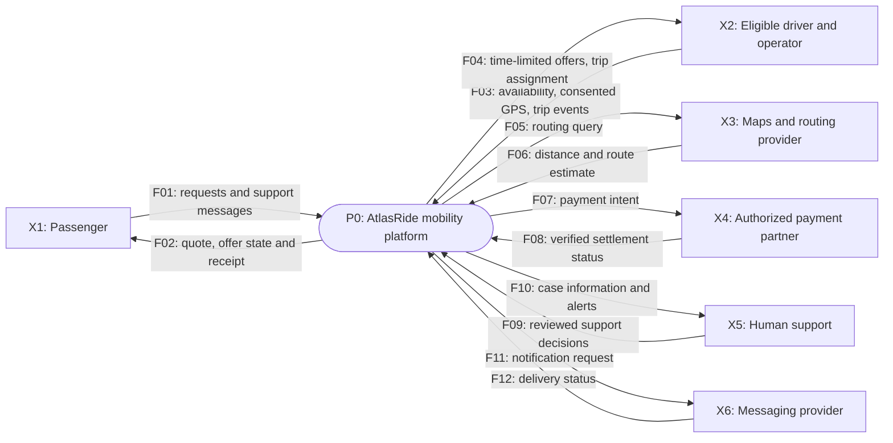
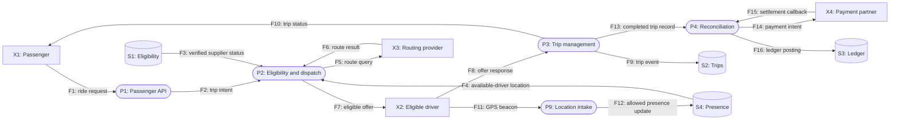
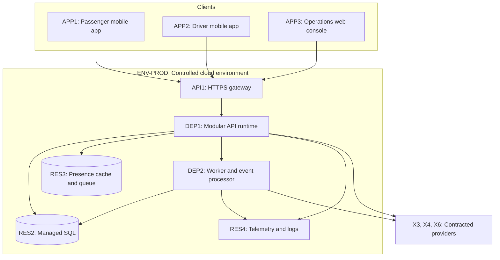
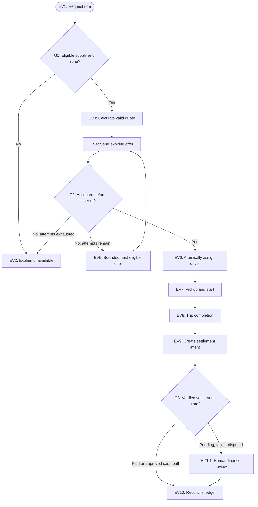
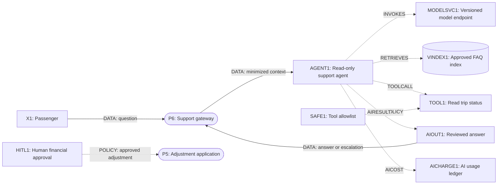
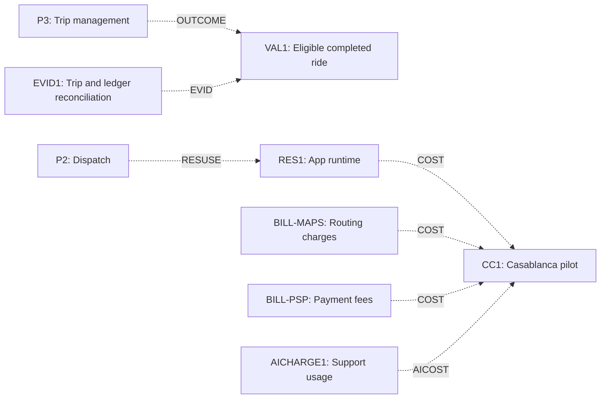

# AtlasRide: modeling a Moroccan mobility startup with UL-xDFD

> **Worked example · UL-xDFD v1.0 · fictional Moroccan startup · documentation case study**


## Contents

1. [Why this case study](#1-why-this-case-study)
2. [The startup and its first release](#2-the-startup-and-its-first-release)
3. [How to build the UL-xDFD model](#3-how-to-build-the-ul-xdfd-model)
4. [L00 — Idea and opportunity](#l00--idea-and-opportunity)
5. [L01 — Discovery and feasibility](#l01--discovery-and-feasibility)
6. [L02 — Requirements and planning](#l02--requirements-and-planning)
7. [L03 — Architecture and design](#l03--architecture-and-design)
8. [L04 — Acquisition and sourcing](#l04--acquisition-and-sourcing)
9. [L05 — Build and implementation](#l05--build-and-implementation)
10. [L06 — Verification and validation](#l06--verification-and-validation)
11. [L07 — Integration and release](#l07--integration-and-release)
12. [L08 — Deployment and transition](#l08--deployment-and-transition)
13. [L09 — Operation and support](#l09--operation-and-support)
14. [L10 — Improvement and evolution](#l10--improvement-and-evolution)
15. [L11 — Retirement and disposal](#l11--retirement-and-disposal)
16. [The 12 UL-xDFD views of AtlasRide](#16-the-12-ul-xdfd-views-of-atlasride)
17. [A complete ride from request to settlement](#17-a-complete-ride-from-request-to-settlement)
18. [Data volumes, infrastructure, and AI consumption](#18-data-volumes-infrastructure-and-ai-consumption)
19. [FinOps: a worked monthly estimate](#19-finops-a-worked-monthly-estimate)
20. [Annotations and model serialization](#20-annotations-and-model-serialization)
21. [Validation, uncertainty, and readiness](#21-validation-uncertainty-and-readiness)
22. [Research exercises and expected artifacts](#22-research-exercises-and-expected-artifacts)
23. [References and repository documentation](#23-references-and-repository-documentation)

---

## 1. Why this case study

A passenger opens an app in Casablanca, chooses a pickup point and destination, and asks for a ride. Behind that short interaction lie several systems and organizations: a licensed transport operator, an eligible vehicle and driver, route and map providers, an application backend, a payment partner, operations staff, and potentially an AI assistant. The startup must decide what information moves between them, but it also needs to know **who may legally perform the trip, how assignments are controlled, how long location data is kept, which failures require human attention, and how much each completed ride costs**.

A conventional data flow diagram (DFD) answers part of this problem. It shows the transfer of requests, locations, trip statuses, and payment events. By itself, it does not describe a driver's authorization, the order in which offers expire, the CI/CD cost of releases, the number of GPS beacons processed every day, or the financial effect of a payment fee charged on the **whole passenger fare** when the startup earns only a portion of it.

**UL-xDFD** uses the DFD as its logical information backbone and attaches other, explicitly typed relationships: requirements, workflow events, ownership, deployment, resource use, cost allocation, policies, and evidence. The same canonical identifiers appear in **12 coordinated modeling views**, while elements and decisions are traced through **12 lifecycle phases (L00–L11)**. AI and agentic components are modeled in these views instead of being left as an unexplained “AI service” box.

In this walkthrough, UL-xDFD helps the founders ask three practical questions:

- **Can the proposed service be built and operated responsibly?** This includes commercial and transport permissions, data protection, payment arrangements, safety, and ownership.
- **What will it consume?** This includes mobile and server traffic, location updates, API calls, storage, CI/CD minutes, staff effort, and optional AI tokens.
- **What can be assessed or optimized later?** This includes architecture alternatives, incident handling, cloud allocation, deployment strategy, and adoption-readiness evidence. Estimates must be compared with future measurements before being treated as predictions.

The terminology is consistent with the [UL-xDFD metamodel](../docs/technical/04-formal-metamodel.md), [element and relationship catalog](../docs/technical/05-elements-edges-notation.md), [annotation contract](../docs/technical/06-annotation-contract.md), and [lifecycle and view definitions](../docs/technical/03-lifecycle-views-stakeholders.md).

## 2. The startup and its first release

### 2.1 The business story

**AtlasRide** is a fictional startup that wants to digitize on-demand urban transport booking. Its first pilot is limited to **Casablanca**. It does **not** assume that a smartphone app can turn any private vehicle into a lawful paid passenger service. Instead, the founders propose a digital reservation and coordination service with transport suppliers whose relevant authorizations, vehicles, drivers, insurance, commercial arrangements, and the platform's own intermediation position have been reviewed.

An AtlasRide passenger can create an account, select pickup/destination points, request an available eligible ride, follow a trip, access a receipt, and request support. A driver uses a separate mobile interface to become available, receive a time-limited offer, accept or decline it, and send trip events. The operator and AtlasRide operations teams use an internal console for eligibility review, dispatch exceptions, financial reconciliation, and safety escalation.

The startup wants to support **Arabic and French**, with Darija phrasing tested in customer support. It uses an external routing/map service and an appropriately authorized payment provider. Cash handling, if allowed by the contractual and regulatory arrangements, follows a separately documented reconciliation process.

AtlasRide may later offer a **read-only AI support assistant** for routine trip questions. It is not entrusted with selecting drivers, determining lawful tariffs, charging or refunding money, handling emergencies, or making safety-critical decisions. Those actions remain in deterministic services and authorized human workflows.

### 2.2 Illustrative pilot assumptions

The figures are chosen for reproducible UL-xDFD exercises. They are not Moroccan market statistics, cloud-provider quotes, or a forecast based on field observations.

| Item | Hypothetical value | Interpretation |
| --- | ---: | --- |
| Pilot city | Casablanca | One city, with explicitly reviewed service zones |
| Eligible drivers | 60 | Authorized individuals/vehicles in the **approved pilot arrangement** |
| Online time | 8 hours per driver per day | Capacity-planning assumption, not a staffing commitment |
| Ride requests | 400/day | Initiated booking attempts; distinct from completed rides |
| Completed rides | 320/day | 80% of requests complete in this simplified scenario |
| Average passenger fare | 46 MAD | Illustrative gross fare, subject to valid operating/tariff rules |
| AtlasRide revenue share | 12% of completed gross fares | Contractual hypothesis, not a standard commission |
| Digitally settled fare share | 70% | Remaining 30% follows an approved cash/other settlement process |
| Payment fee paid by platform | 1.8% of digitally settled gross fare | Assumed commercial model; could differ by contract |
| Driver location interval | Every 15 seconds while online | Starting hypothesis; not a constant safety requirement |
| Application location payload | 0.45 KiB/update | Logical payload before transport overhead |
| AI-assisted support interactions | 15% of completed rides | One interaction per selected ride, **assumed** |
| Modeled month | 30 days | Common denominator for demand and cost calculations |

This is scenario **`SC-PILOT`**. Additional scenarios will be `SC-PEAK`, `SC-MAPS-OUTAGE`, `SC-PAYMENT-DELAY`, `SC-DRIVER-NETWORK-LOSS`, `SC-AI-OUTAGE`, and `SC-GROWTH`. A scenario has its own assumptions and measurement window; no scenario automatically inherits a uniform cost multiplier.

### 2.3 Regulatory and business boundary: a real go/no-go gate

Moroccan passenger transport and transport-intermediation permissions require case-specific verification. Government and parliamentary materials have described authorization requirements for vehicles, drivers, and intermediation, while later reporting confirms continuing regulatory scrutiny of application-based services [M1–M2]. AtlasRide therefore **must not dispatch paid real-world journeys before its actual operating structure has been approved by competent parties and authorities**. A software demo may use synthetic drivers, simulated rides, and sandbox payment events while that work is pending.

The platform also handles account identities, professional verification documents, precise geolocation, pickup/drop-off points, trip histories, and payment references. These create obligations under **Morocco's Law 09-08** and applicable **CNDP** procedures; foreign hosted services require a separate data-transfer assessment where relevant [M3–M5]. AtlasRide must use an authorized payment arrangement and settle contractual responsibility for collections, payouts, reversals, chargebacks, and refunds [M6]. This example is a modeling guide, not legal advice or a finding that any proposed pricing or operating model is permitted.

**Go/no-go record `G-LEGAL`:** the MVP can proceed to a controlled **simulated** release before legal sign-off; a live paid pilot is blocked until the transport, intermediation, insurance, data protection, and payment reviews are accepted and evidenced.

### 2.4 System boundary and explicit exclusions

**Inside AtlasRide:** passenger API, operator/driver account management, eligible-driver registry adapter, availability and dispatch, trip state machine, fare/receipt records, payment reconciliation, customer support, notifications, event telemetry, AI support gateway, and delivery pipeline.

**External:** passengers, contracted authorized transport suppliers and drivers, competent authorities, map/routing provider, payment/acquiring provider, SMS/push provider, optional model-hosting provider, and external auditors or insurers.

**Out of scope for the initial pilot:** dispatching unauthorized private cars; unapproved surge pricing; autonomous financial adjustments; AI-based safety triage; self-operated payment custody; unrestricted driver scoring; dynamic insurance underwriting; nationwide coverage; driver-facing pay changes without contractual authorization.

## 3. How to build the UL-xDFD model

Create one canonical project model and progressively enrich it. Never maintain twelve unrelated diagrams that can disagree about the identity of the trip service.

**Suggested initial records:**

| Record class | Example IDs | What the researcher records |
| --- | --- | --- |
| Business and value | `IDEA1`, `VAL1`, `USE1` | Reason for digitization; one lawfully completed ride as the primary value unit |
| External entities | `X1`–`X6` | Passenger, eligible driver/operator, maps, payment partner, support, messaging provider |
| Logical processes | `P1`–`P9` | Identity, quoting, dispatch, trip state, settlement, support, eligibility, notifications, location ingestion |
| Logical stores | `S1`–`S6` | Identity/eligibility, trips, financial ledger, location telemetry, support/policies, audit/events |
| Requirements | `REQ1`–`REQ12` | Legal gate, data minimization, operational correctness, cost, quality and security |
| Workflow controls | `EV1`–`EV10`, `G1`–`G4` | Request, quote, offer, accept, pickup, completion, timeout, settlement, review |
| Software and delivery | `APP1`, `API1`, `REPO1`, `PIPE1`, `ART1`, `DEP1` | Mapping to implementation and release process |
| Resource and finance | `RES1`–`RES5`, `CC1`, `BILL1`–`BILL5` | Runtime, database, map usage, messaging, cloud costs, cost center |
| AI profile | `AISYS1`, `AGENT1`, `AGRUN1`, `MODELSVC1`, `VINDEX1`, `TOOL1`, `SAFE1`, `HITL1`, `AICHARGE1`, `AIOUT1` | Read-only support architecture, metering, evaluation and supervision |
| Evidence and outcomes | `EVID1`–`EVIDn`, `OUT1`–`OUTn` | Authorizations, tests, rate cards, invoices, measured workload and later results |

**Read the relationship, not just the arrow.** `X1 -DATA:F1-> P1` means a passenger's request data reaches an API. It **does not** mean P1 must execute after a different step. `EV1 -WORK-> EV2` models sequence; `ROLE1 -OWN-> P2` models responsibility; `DEP1 -RESUSE-> RES1` models resource demand; `BILL1 -COST-> CC1` assigns a charge. The [relationship catalog](../docs/technical/05-elements-edges-notation.md) defines these distinct meanings.

**Build order for this case:** record goals and context → establish the V0 data skeleton → add V2 workflow and exceptions → add V3 owners and V8 controls → map V4/V5 implementation → attach V6/V7 delivery/operations → quantify V9 costs → preserve V10 evidence and V11 lifecycle decisions. AI is added as a cross-view profile, not a separate thirteenth view.

For every numeric annotation, state its unit, scenario, period, per-request/per-replica scope, status, evidence source and uncertainty. In this document, initial numeric inputs have status **`hypothetical`**.

---

## L00 — Idea and opportunity

**Story.** Three founders notice that booking an eligible ride can involve uncertain availability, repeated telephone calls, and limited trip-status visibility. They propose a digital reservation platform that reduces this friction without changing who is legally allowed to transport passengers.

**Create in UL-xDFD:** `IDEA1` (digitize authorized ride booking), `VAL1` (completed eligible ride), `USE1` (book and complete a ride), `ROLE1` (product founder), `CC1` (Casablanca pilot budget), and `CHG1` (business-model decision). Attach a demand hypothesis, business owner, projected pilot population, feasibility horizon and explicitly unknown market adoption.

The founders consider two alternatives: `ALT1`, a digitization/booking layer for existing authorized operators; and `ALT2`, a platform that attempts to recruit arbitrary private cars. The second is **not an eligible launch design** without an acceptable legal basis. It is documented as a rejected or blocked alternative, not represented as an implemented technical feature.

**Questions answered:** What customer problem is solved? Who is the operator of record? What counts as a successful outcome? Who bears dispatch liability and payment fees? Should an AI component exist at all?

**Decision and evidence:** an opportunity brief, scope boundaries, user-journey hypothesis, list of affected stakeholders, and a funding decision for **discovery only**. No validated demand or readiness score exists at this point.

**Primary views:** V1, V3, V9, V10, V11.

## L01 — Discovery and feasibility

**Story.** The founding team interviews authorized transport suppliers, potential passengers, dispatchers, legal counsel and payment providers. Requirements emerge that would not appear in a screen mockup: driver/vehicle eligibility changes, cancellations, fare disputes, coverage areas, interruptions of cellular data, missed pickup, and independent verification of settlement events.

**Create in UL-xDFD:** `X1` Passenger, `X2` Authorized driver/operator, `X3` Maps provider, `X4` Payment partner, `X5` Support/operations, and `X6` Messaging provider, plus boundary `B1` AtlasRide platform and trust boundaries for third-party services. Record legal decisions as `REQ1` and risk `RISK1`, with accountable roles and evidence placeholders.

Discovery must explicitly ask what the startup **cannot** assume. An app's request button is not a transport authorization; a geographic coordinate is not a permanent permission to track a person; an online-payment SDK does not make the platform a licensed payment provider. Confirm who contracts with the passenger, who presents or determines the fare, whether operator-side rules limit acceptance/assignment, and how incidents reach humans. Protect professional verification documents and limit who can access them.

**Evidence to collect:** counsel's legal analysis and any competent authority correspondence, operator/license documents, insurance/driver eligibility checks, route-provider terms, a draft data inventory, PSP terms, qualitative interview notes, and unresolved disagreements. Do not invent approval numbers or an authorization receipt for the example.

**Decision:** `G-LEGAL` holds the live paid launch. If unresolved, engineers may proceed with mock drivers, synthetic trips and provider sandboxes only. A regulator/operator confirmation must be revisited if the commercial or intermediation arrangement changes.

**Primary views:** V0, V1, V3, V8, V10, V11.

## L02 — Requirements and planning

**Story.** The team turns the use case into testable obligations. “Fast matching” is not a sufficient requirement; the requirement must specify the event, percentile, scenario, and measurement boundary.

| ID | Proposed requirement or acceptance target | Verification method |
| --- | --- | --- |
| `REQ1` | Only verified and currently eligible operators, vehicles and drivers receive offers | Eligibility fixtures, expiration tests and reviewed authorization evidence |
| `REQ2` | Each passenger request produces at most one active confirmed assignment | Concurrent acceptance and race-condition tests |
| `REQ3` | Driver offers expire; stale offers cannot be accepted | Timeout and retry tests |
| `REQ4` | P95 quote calculation **target** ≤ 1.5 s under a specified pilot load, excluding provider outage | Controlled load test with trace boundaries |
| `REQ5` | P95 dispatch decision **target** ≤ 3 s for eligible-driver availability, excluding the driver's response delay | Trace-based pilot test; separate driver-wait metric |
| `REQ6` | Payment callbacks are authenticated, idempotent and reconcilable | Duplicate, reordered, forged and delayed callback tests |
| `REQ7` | Passenger and driver can recover a trip state after temporary connectivity loss | Offline/reconnect tests and state-machine checks |
| `REQ8` | Precise GPS is not retained without a documented purpose, access policy and reviewable retention rule | Data-flow and database audits, CNDP/privacy review |
| `REQ9` | AI assistant uses only approved, read-only functions and sources; incidents and refunds escalate | Adversarial agent tests and human-workflow checks |
| `REQ10` | Technology usage is attributable to product, environment, scenario and cost center | Cost-allocation reconciliation and invoice tests |
| `REQ11` | Service availability **objective** 99.9% measured over an agreed window; exclusions specified | Production monitoring after launch |
| `REQ12` | A release has reproducible artifact, security scan, approval and rollback evidence | CI/CD evidence and staged rehearsal |

Create `SC-PILOT`, `SC-PEAK`, `SC-PAYMENT-DELAY`, `SC-MAPS-OUTAGE`, `SC-OFFLINE`, and `SC-GROWTH`. Attach business assumptions, acceptable limits, critical controls and stakeholders. Define the pilot team's provisional roles: product, legal/compliance, transport partnership, engineering, platform/DevOps, QA, SRE, security/privacy, finance/FinOps, and support.

Specify the first **quality-critical journeys**: eligible booking, no-driver-available, driver decline, passenger cancellation, failed payment, disputed fare, emergency/safety escalation, and network loss. Each exception must have an owner, not merely a generic error screen.

**Decision and evidence:** an approved MVP backlog, acceptance-test specification, traceability matrix, risk and budget registers, environment plans, and an explicit `unknown` list. None of the P95 values above is a measured result.

**Primary views:** V1, V2, V3, V8, V9, V10.

## L03 — Architecture and design

**Story.** The architect first describes **logical work and information circulation**, then maps it to code and cloud resources. The first implementation uses one modular backend with background workers. Independent microservices are not automatically required for a modest pilot.

### L03.1 Level-0 context DFD (V0)

Every arrow in this first diagram represents an actual directed **data transfer**. Workflow order and ownership are intentionally omitted.



`P0` is the **logical system boundary process**, not a single deployable container. Its Level-1 refinement must reconcile its external exchanges with the corresponding Level-0 flows. The platform must not be connected directly from an external actor to an internal data store.

### L03.2 Process and store inventory (Level 1)

| ID | Logical process | Typical stores and contracts |
| --- | --- | --- |
| `P1` | Passenger and account API | `S1` identity/account; authentication contract |
| `P2` | Eligibility-aware quote and dispatch | `S1` verified eligibility; `S4` current availability; `X3` routing |
| `P3` | Trip lifecycle/state management | `S2` trips; state-transition events |
| `P4` | Payment coordination/reconciliation | `S3` financial ledger; `X4` payment provider |
| `P5` | Authorized refund/adjustment application | `S3`; approved human decision and PSP contract |
| `P6` | Customer-support gateway | `S5` support cases and approved policies |
| `P7` | Supplier/driver eligibility review | `S1` license, vehicle/driver status and review dates |
| `P8` | Notification orchestration | `X6` messaging provider; delivery logs |
| `P9` | Location update ingestion and filtering | `S4` approved minimal telemetry; current presence cache |
| `S1` | Identity and eligibility logical store | Account and verification/authorization references |
| `S2` | Trip and state-event store | Requests, assignments, cancellations, completion |
| `S3` | Financial ledger and reconciliation records | PSP correlation, settlement, adjustments and disputes |
| `S4` | Location/presence store | Current online position and purpose-limited history |
| `S5` | Support cases and knowledge | Policies, tickets, audit of human actions |
| `S6` | Audit/metrics/event records | Technical traces, quality, consent and evidence pointers |

Stores are **logical**. Several may share one managed SQL cluster initially. `S4` should distinguish a short-lived presence cache from any justified historical retention; merging them into one indefinite location history would conceal a privacy decision.

### L03.3 Level-1 ride-booking data flows (V0)

This DFD names the messages explicitly. It does not assert that every message arrives synchronously or successfully.



The diagram deliberately exposes **`P3` and `P4` as separate logical responsibilities**. A trip can be completed while a payment is pending; payment failures do not erase the trip's historical state. Not all driver location updates should be stored as durable historical events.

### L03.4 Software and deployment mapping (V4/V5)

The deployment view is **not another DFD**: its edges represent hosting/technical dependency, not transfers of business data. It is still connected to the same `P` IDs via implementation/allocation relationships.



**Logical-to-physical mapping:** `P1–P9 -CODE-> APP/API/DEP` components; `DEP1 -HOST-> RES1`, `DEP1 -RESUSE-> RES2/RES3`, `DEP2 -RESUSE-> RES4`, and provider costs flow to `CC1` through `BILL` records. Choose concrete cloud products only after a workload/cost comparison and a data-protection review. No cloud vendor is required by the metamodel.

**Decision and evidence:** publish the context and Level-1 DFD, message contracts, ownership map, trust boundaries, deployment mapping, scaling assumptions, failure modes and outstanding decisions. Document alternate choices (modular backend vs microservices; hosted managed resources vs self-managed resources) as `ALT` edges rather than declaring one optimal by intuition.

**Primary views:** V0, V2, V3, V4, V5, V8.

## L04 — Acquisition and sourcing

**Story.** AtlasRide selects providers and commercial partners before engineers depend on their services. A cheap-looking route API may have unpredictable per-request fees, and a hosted AI service may process customer text outside the permitted data boundary.

**Create in UL-xDFD:** versioned contracts/requirements for transport operators, mapping/geocoding, mobile push/SMS, cloud hosting, managed SQL, security scanning, payment acquiring, and optional AI inference. Attach `BILL` and `CC` references, supplier obligations, renewal dates, regions, service limits, privacy constraints, and exit alternatives.

| Procurement decision | What must be recorded |
| --- | --- |
| Transport partners | Permitted service model, authorization evidence, insurance, role in customer contract, live eligibility updates |
| Maps and routing | Pricing per route/geocode request, quotas, caching rights, location processing region, failure behavior |
| Payments | Authorized provider, fees on gross fare vs platform share, reconciliation format, refunds and chargebacks |
| Cloud/runtime | Region, data processing, backups, availability, egress and commitment terms |
| Communications | SMS/push pricing, opt-in rules, deliverability, language and incident fallback |
| AI inference | Provider/model/version, unit token prices, retention/training terms, processing locality, rate limits |
| Third-party software | License, security provenance, maintenance status, support and exit costs |

Do **not** insert a current vendor price merely because one exists online; the actual contract, currency conversion, tax treatment and effective date determine the modeled rate. Validate whether the operator, startup, passenger, or PSP actually bears each charge.

**Decision and evidence:** signed contracts or reviewable quotations, a vendor-risk register, rate-card versions, privacy decisions, source/license references and an approved procurement budget. `G-LEGAL` still controls the paid launch.

**Primary views:** V3, V4, V8, V9, V10, V11.

## L05 — Build and implementation

**Story.** The first sprint produces the account, eligible-driver, quote, assignment, trip, and ledger modules. The product team refuses to equate feature completion with a working ride service; every workflow must also have a testable failure path.

**Create in UL-xDFD:** `REPO1` for backend and infrastructure code, `REPO2` for mobile clients, `API1` for passenger/driver contracts, `PIPE1` for CI, `ART1` for signed build artifacts, `TEAM1` for engineering, and `EVID` links to code, tests and decisions.

Implementation details worth making visible:

- **Eligibility:** a driver offer requires an up-to-date approved eligibility record. The cache is a performance aid, not a replacement for authorization checks at assignment.
- **Atomic assignment:** the platform enforces one successful assignment per request even when two drivers accept simultaneously.
- **Trip state machine:** states such as `requested`, `offered`, `assigned`, `arrived`, `in_progress`, `completed`, `cancelled` have explicit allowed transitions. A completed trip is not automatically a settled payment.
- **Connectivity:** driver updates have event IDs, timestamps, sequence constraints and defined offline reconciliation rules.
- **Payments:** never store raw card credentials; authorize and verify callbacks through the contracted payment system. Use idempotency keys and a separate financial ledger.
- **Privacy:** enforce role-based access to driver documents, limit precise location exposure, and avoid logging sensitive payloads in development telemetry.
- **Support:** safety-sensitive incidents, lost property and payment disputes reach trained humans; an FAQ assistant is not a decision-maker.

Track engineering effort by role and lifecycle phase as **development cost**, not cloud operating expense. Link requirements to tests and modules with `REQMAP`/`CODE` edges, and record which estimates are still unverified.

**Decision and evidence:** reproducible builds, repository references, API contracts, unit/integration test records, threat-model review, and developer time estimates.

**Primary views:** V3, V4, V6, V8, V9, V10.

## L06 — Verification and validation

**Story.** Engineers demonstrate that AtlasRide handles operationally difficult cases rather than only the happy path. They also measure how the service behaves under realistic burst patterns; the 400 daily ride requests are not uniformly distributed.

| Test group | Scenario | Evidence or metric |
| --- | --- | --- |
| Authorization | Expired driver/operator permission | Offer blocked; audited denial |
| Concurrency | Two drivers accept one request | Exactly one assignment committed |
| Dispatch | No available eligible driver | Bounded search, honest no-availability response |
| Cancellation | Rider/driver cancels at different stages | Policy-based fare/notification outcome, event audit |
| Provider failure | Map API quota exceeded or times out | Controlled timeout and fallback; no fabricated ETA |
| Payments | Duplicate, late, reordered or forged callback | One ledger effect per valid transaction, reconciled state |
| Connectivity | Driver offline before/after trip completion | No double completion; eventual repair with evidence |
| Performance | Peak arrival and offer fan-out | Queue length, P95/P99, CPU, cache misses, database contention |
| Privacy | Stale GPS retention and unauthorized support query | Access denied, deletion/retention audit |
| AI | Prompt injection, fabricated refund, private record request | Tool denied, response evaluated, human escalation |
| Disaster recovery | Restore database and replay events | Measured recovery duration, reconciliation completeness |

For each result, store actual sample size, workload, environment, timestamps, test version and status **`observed`** only if a test has genuinely run. In this fictional walkthrough, all test outcomes are **planned**, not recorded successes.

**Decision and evidence:** quality gate results, penetration-test findings, load-test traces, recovery exercise, safety review, and an explicit hold list. A functional UI does not close `REQ1` or `G-LEGAL`.

**Primary views:** V2, V5, V6, V7, V8, V10.

## L07 — Integration and release

**Story.** A code change passes automated checks, is packaged and promoted to a pilot staging environment. The team treats payment and eligibility changes as high-risk, requiring review even when ordinary deployments are automated.

**Create in UL-xDFD:** pipeline activities `PIPE1` lint/build, `PIPE2` unit/integration, `PIPE3` SAST/SCA/secrets/IaC and artifact provenance, `PIPE4` end-to-end/recovery tests, gate `G-RELEASE`, artifact `ART1` and deployment `DEP1`. Link them using **`DEL`** and **`WORK`** relationships, not `DATA` merely because files flow through CI.

A demonstration timing model assumes: build 8 minutes, tests 12 minutes, security scans 6 minutes, deployment 5 minutes. Sequential sum = **31 minutes**. This is not a measured lead time: a parallel pipeline's critical path can be shorter, while a human approval or failed retry can dominate elapsed time. Record CPU-minutes, runner billing, external scanner licenses, queue wait and artifact retention separately.

Requirements for release evidence include commit SHA, SBOM/security report where applicable, artifact digest, approval record, deployment environment, migration plan, rollback artifact and proof of staged financial reconciliation.

**Decision:** the system may be technically releasable in a sandbox while the live operating gate remains blocked. A software release approval and a transport/legal launch approval are different decisions.

**Primary views:** V2, V3, V6, V8, V9, V10, V11.

## L08 — Deployment and transition

**Story.** AtlasRide prepares the first controlled environment: two mobile apps, the operator console, the modular backend, workers, database, cache, metrics and secrets. The team rehearses release, rollback, backup restoration, and isolation of test accounts.

**Create in UL-xDFD:** `ENV-STAGE`, `ENV-PROD`, `DEP1/DEP2`, `RES1–RES5`, region and availability-zone annotations, scaling bounds, secrets handling, monitoring coverage, backups, data residency and cost-center links. Provision with IaC where practical; keep an approval record for production changes.

The startup should use separate provider keys for sandbox and live systems. Test payments must never settle real funds. Before the pilot, verify that eligible-driver data is current, maps usage is rate-limited, and requests are rejected in unapproved service zones. The release plan includes a **feature kill switch** that disables new ride requests without corrupting existing trip or ledger records.

**Transition gate:** obtain verified transport/payment/privacy sign-offs for paid operation, demonstrate incident contacts, and complete the operational handover. Without them, limit deployment to simulation or authorized testing contexts.

**Primary views:** V4, V5, V6, V7, V8, V9, V11.

## L09 — Operation and support

**Story.** During a hypothetical pilot month, the startup attempts 400 bookings per day, completes 320 rides per day, and sees much more GPS traffic than booking traffic. Its daily concern shifts from “does the app work?” to “can we trust and explain the outcomes?”

Observe request rates, assignment conflicts, quote/dispatch latency, driver location freshness, map API failures, payment lag, customer complaints, cancellation rates, retry counts, infrastructure usage and costs. Track **service** metrics separately from **business** outcomes: low CPU consumption does not mean the platform is profitable or that passengers found authorized rides.

An incident runbook specifies who can stop new dispatch, who communicates to partners, who resolves a missing completion event, who may issue a financial adjustment, and who provides the audit record. Trip completion and financial settlement are monitored as separate consistency domains.

For AI support, record billed tokens, model calls, retrievals, approved tool invocations, escalations, verified answer quality and provider failures. A model's fluent answer is not a verified resolved support ticket.

**Evidence state:** the case's 320 rides/day and cost figures remain hypothetical. In a real deployment, replace those with time-stamped usage records, invoices, audited operator records, load profiles and reviewed customer outcomes; preserve the original baseline snapshot for comparison.

**Primary views:** V2, V5, V7, V8, V9, V10.

## L10 — Improvement and evolution

**Story.** With measurements in hand, AtlasRide compares targeted changes. The first cost-saving idea is to reduce GPS updates; the team must check its effect on ETA accuracy and safety before declaring an optimization.

| Alternative | Hypothesis | Required safety/quality guardrail | Measurement |
| --- | --- | --- | --- |
| `ALT-LOC` | Change eligible online location update from 15 s to 30 s in approved conditions | Dispatch freshness, tracking quality, safety and consent remain acceptable | Payload count, stale-asset rate, user impact, network cost |
| `ALT-CACHE` | Cache selected routing lookups within provider terms | No stale/incorrect routes and acceptable ETA error | Paid API requests, cache hit ratio, ETA deviation |
| `ALT-SCALE` | Tune backend capacity by observed bursts | Request latency/error budget maintained | vCPU-hours, queue delay, availability |
| `ALT-AI` | Use deterministic FAQ before AI escalation | Verified helpfulness and accessibility maintained | Successful-task cost, human escalations, hallucination rate |
| `ALT-CICD` | Run affected tests/approved scanners adaptively | Critical security checks never skipped | Pipeline minutes, risk coverage and escape defects |

A **30-second location interval** would mathematically halve regular beacons *under the same online-driver schedule*, from 115,200 to **57,600 events/day**. It does **not** imply a 50% reduction in the cloud bill: fixed resources, routing fees, maps traffic, databases, security and support remain. It may also degrade matching freshness. Compare controlled scenarios with identical demand and defined quality constraints, not unrelated months.

For DevOps or DevSecOps adoption, track actual changes in lead time, failure recovery, policy compliance and coordination. A readiness diagnostic is not proof of future success.

**Decision and evidence:** a pre-registered experiment, alternatives graph, matched demand and pricing assumptions, cost/risk guardrails, reviewed before/after results, and rollback criteria.

**Primary views:** V5, V6, V7, V9, V10, V11.

## L11 — Retirement and disposal

**Story.** If the pilot fails commercially, loses an operating partnership, changes markets or replaces a provider, AtlasRide needs an orderly exit rather than an abandoned database of precise trip locations.

**Create in UL-xDFD:** retirement `CHG` record, data inventory and deletion/retention requirements, contract exit costs, export plan for permitted records, deprovisioning of environments, credential revocation, app-store communication, and evidence of completed deletion where lawful. Financial records and disputed claims may have different legally justified retention needs from transient location beacons.

AI retirement includes disabling tools, deleting/rebuilding indexes where appropriate, handling prompts and conversation logs, and confirming provider-side deletion obligations. For each sensitive store, identify the real custodian, backup copies and third-party processing boundary.

**Decision and evidence:** approved retirement plan, retained-records register, reconciled customer and operator balances, revoked permissions, provider attestations, and final cost/closure report. Retirement is part of full lifecycle FinOps; ending infrastructure charges does not automatically end contractual liabilities.

**Primary views:** V3, V8, V9, V10, V11.

---

## 16. The 12 UL-xDFD views of AtlasRide

The views below are **projections of the same model**, not separate documents containing different identifiers. See the formal [view contract](../docs/technical/03-lifecycle-views-stakeholders.md).

| View | What it shows for AtlasRide | Example question or evidence |
| --- | --- | --- |
| **V0 — Logical data** | Passengers, drivers, routing, trip/ledger stores, precise location and AI support data | Where do pickup coordinates move and who receives them? |
| **V1 — Demand, value and requirements** | `IDEA1`, `VAL1`, `USE1`, `REQ1–12`, cost and service targets | What is a completed **eligible** ride, and what blocks launch? |
| **V2 — Workflow, events and time** | Driver offer expiry, first acceptance, cancellation, payment retries, manual approvals | What happens when an offer expires or PSP callback repeats? |
| **V3 — People and governance** | Founders, permitted operators, engineers, finance, legal/privacy and support | Who decides a driver's eligibility and authorizes a refund? |
| **V4 — Software and architecture** | Passenger/driver apps, dispatch, trip module, ledger, APIs, AI support | Which module implements `P2`, and what are its data contracts? |
| **V5 — Workloads, infrastructure and capacity** | Driver beacons, arrival bursts, CPU, RAM, caches, SQL, queues, AI tokens | Can the system process location updates without waste? |
| **V6 — Delivery, testing and DevSecOps** | Repositories, security scanning, staged release, CI minutes and rollback | Which pipeline evidence supports deployment approval? |
| **V7 — Operations and reliability** | Availability, support, event replay, settlement lag, telemetry, incident runbooks | Can it recover without double-completing or double-charging? |
| **V8 — Security, privacy and compliance** | Role restrictions, transport eligibility, CNDP controls, payment trust and agent permissions | Who may access exact GPS history or issue payment actions? |
| **V9 — FinOps and sustainability** | Compute, maps, SMS, payment charges, labor, AI and cost per completed ride | Why does a fee on the full fare matter to unit economics? |
| **V10 — Evidence, uncertainty and outcomes** | Sandbox tests, hypothetical vs measured annotations, approvals, invoices, outcomes | Which claims are measurements, assumptions or unresolved? |
| **V11 — Lifecycle, decisions and change** | L00–L11, snapshots, operator changes, provider alternatives and improvements | What changed between feasibility, launch and optimization? |

A developer can select V0 to review trip data and then V9 to inspect its costs. The logical trip process remains `P3` in both views. If cost or owner information is missing, the model exposes missing evidence; it does not silently manufacture it.

## 17. A complete ride from request to settlement

### 17.1 The workflow is not a DFD (V2)

The graph below shows **control/temporal precedence**, including a bounded retry. Its arrows are not additional data-flow records. Human authorization and payment reconciliation remain visible.



`G1` is a technical eligibility decision backed by verified supplier information, not legal authorization to start the whole service. `G-LEGAL` remains a separate organizational gate before any paid pilot.

### 17.2 Three correlated traces for the same journey

**Data trace (V0):**

```text
X1 Passenger -F1: ride request-> P1 PassengerAPI
P1 -F2: trip intent-> P2 Dispatch
S1 Eligibility -F3: current operator/driver status-> P2
S4 Presence -F4: eligible nearby positions-> P2
P2 -F7: time-limited offer-> X2 AuthorizedDriver
X2 -F8: acceptance event-> P3 TripManagement
P3 -F9: trip state event-> S2 TripStore
P3 -F13: completed-ride record-> P4 PaymentReconciliation
P4 -F14: charge intent-> X4 PaymentPartner
X4 -F15: signed status-> P4
P4 -F16: ledger posting-> S3 Ledger
```

**Control trace (V2):** `EV1 -WORK-> G1 -DEC-> EV3 -WORK-> EV4 -WORK-> G2 -DEC-> EV6 -WORK-> EV7 -WORK-> EV8 -WORK-> EV9 -WORK-> G3 -DEC-> EV10` with an explicit offer-timeout loop and a financial exception branch.

**Cost/evidence trace (V9/V10):** `P2 -RESUSE-> RES1` and `P2 -COST via BILL-MAPS-> CC1`; `P9 -RESUSE-> RES2/RES3`; `P4 -EVID-> EVID-SETTLEMENT`; `BILL-PSP -COST-> CC1`; `OUT-RIDE -EVID-> EVID-COMPLETION`. Actual costs require correlation IDs, billing records and declared allocation rules. `OUT-RIDE` is an observed value only once independent proof exists.

### 17.3 Exceptions as first-class requirements

| Exception | Safe behavior | Responsible element and evidence |
| --- | --- | --- |
| No eligible transport supplier | Do not dispatch; tell passenger no service is available | `REQ1`, `P2`, `G1`, eligibility evidence |
| Driver ignores/declines offer | Expire and retry a bounded set; never reuse stale offer | `G2`, `EV4/EV5`, timeout tests |
| Multiple driver acceptances | One assignment wins; other acceptances rejected | `P3`, atomic-assignment transaction test |
| Passenger cancellation | Apply reviewed policy and document any charge/waiver | `P3`, policy record, human dispute path |
| Driver temporarily offline | Reconcile sequence-numbered events without duplicate completion | `P3`, offline replay protocol |
| Duplicate payment callback | Verify source, apply one financial effect and keep an audit trail | `P4`, `S3`, webhook tests |
| Map provider unavailable | Bound retries; offer no fabricated ETA or unauthorized service | `P2`, provider incident/runbook |
| Safety incident | Immediate human escalation; preserve appropriate evidence | `P6`, `HITL1`, incident owner |
| AI gives dangerous or false advice | No protected action; stop/escalate to support | `SAFE1`, `EVAL1`, human approval |

## 18. Data volumes, infrastructure, and AI consumption

### 18.1 Demand and location volume

For **60 drivers online 8 hours/day**, each sending one location update every **15 seconds**:

```text
Updates per driver per day = 8 × 3,600 / 15 = 1,920
Driver location updates per day = 60 × 1,920 = 115,200
Updates per second in assumed 8-hour online period = 115,200 / 28,800 = 4
Monthly updates (30 days) = 3,456,000
Raw logical payload per update = 0.45 KiB
Raw incoming payload per day = 115,200 × 0.45 / 1,024 = 50.625 MiB
Raw incoming payload per 30-day month = 1,518.75 MiB (~1.48 GiB)
```

This **does not** include network headers, TLS, repeated sends, push notifications, route lookups, replication, backups, logging or the location stream sent to passengers. The raw traffic calculation cannot determine a cloud bill without storage policy, service rates, deployment region and actual traffic traces.

Booking attempts: `400/day × 30 = 12,000/month`. Completed rides: `320/day × 30 = 9,600/month`. During the eight-hour window, the **average booking-attempt rate** is only `400/28,800 ≈ 0.0139 requests/s`. That average is almost useless for peak sizing on its own: bookings cluster around commute peaks, large events and weather changes, while matching can fan out to multiple eligible drivers.

### 18.2 Workload and retention annotations

| Flow/store | Suggested workload annotation | Design consequence |
| --- | --- | --- |
| `F1` Passenger request | 400 attempts/day, burst distribution **unknown** | Measure peak arrivals and abuse limits |
| `F7` Driver offer | Number of offers per booking **unknown** | Retry/fan-out costs cannot yet be estimated |
| `F11` Location beacon | 115,200/day, 0.45 KiB each | Rate limits, freshness and minimized persistence |
| `S2` Trip store | 9,600 completed trips/month; event size **unknown** | Need measured index/storage growth |
| `S3` Financial ledger | Settlement/callback cardinality **unknown** | Need PSP behavior and audit retention |
| `S4` Location presence | Frequent updates, retention **undecided** | Favor short-lived presence; justify any history |
| `X3` Maps provider | Queries per quote/ride **unknown** | Vendor bill forecast incomplete |
| `X6` Messaging provider | Sends per status change **unknown** | SMS/push cost must be separately modeled |

Do not infer network or storage capacity simply from the number of DFD edges. Record resource requirements per named workload scenario, including cache memory, concurrent sessions, replication, recovery point, database transactions, and the permitted region.

### 18.3 Architecture sizing: an illustrative calculation, not a recommendation

For an intentionally hypothetical baseline, suppose each location update consumes **5 ms of CPU time** in the ingestion application (excluding database and external I/O). At **4 updates/s**, average CPU demand is `4 × 0.005 = 0.02 core-seconds/s`, or approximately **0.02 fully utilized CPU cores** for this *one processing step*. This is **not** enough to size the application: peak burst, encryption, validation, persistence, queueing, contention, minimum replicas, availability and dispatch work may dominate. Do not turn this example into a claim that 0.02 cores can run AtlasRide.

For each process, write demand as `arrival_rate × measured_cpu_seconds_per_event`; account separately for data-store operations, external API work, parallelism and headroom. Use controlled load tests, not invented IPC or CPU frequency conversions, to establish production demand.

### 18.4 AI support: bounded autonomy, traceable cost

AtlasRide's first AI capability is **optional read-only assistance**, not autonomous transport control. A passenger asks, “Where is my driver?” or “How do I report a wrong receipt?” The agent retrieves approved help articles and may query a restricted trip-status function after server-side authentication. A human handles financial adjustments, driver disputes and incidents.



The dashed relationships denote **AI invocation, retrieval, policy and cost**, not automatically raw business data movement. In a canonical model, actual prompt/context and response payloads are separately represented with `DATA` records and privacy annotations. `SAFE1` means **application-side enforced policy**, not a text instruction to the LLM. `HITL1` is required for protected adjustment operations, which the agent itself cannot execute.

**AI annotation and evaluation contract:**

| Topic | Requirement |
| --- | --- |
| Allowed task | Approved FAQ explanation and scoped, authenticated trip-status lookup |
| Prohibited tasks | New dispatch, fare-setting, refund, charge, driver suspension, safety determination |
| Model | Versioned provider/model endpoint with processing-region and retention review |
| Tools | Read-only `TOOL1`, server-side authorization and user-trip ownership checks |
| Retrieval | Approved `CORPUS1`, versioned `VINDEX1`, citation/fallback rules |
| Agent limits | Max steps, token cap, retries, timeout and cost cap; values fixed before deployment |
| Human path | `HITL1` for disputes, account changes, safety and payment adjustments |
| Safety tests | Indirect prompt injection, cross-user trip lookup, invented fare/refund, misleading answer |
| Outcome | Human-reviewed correct answer or appropriately escalated request; not just any generated reply |

Under the hypothetical **15% AI support interaction rate**, the model has `320 × 0.15 = 48` support interactions/day, or **1,440/month**. If the estimate assumes **one model invocation per interaction** with 1,200 billable input and 300 billable output tokens:

```text
AI interactions/month           = 1,440
Model calls/month (assumed)      = 1,440
Input tokens/month              = 1,440 × 1,200 = 1,728,000
Output tokens/month             = 1,440 × 300   =   432,000
Illustrative LLM charge (MAD)   = 1.728 × r_in + 0.432 × r_out
```

`r_in` and `r_out` are the actual **MAD per million input/output token** rates for a dated and specified provider/model. Cached tokens, unsuccessful calls, retries, system prompts, tool results, retrieval costs and usage tiers require separate metering. We do **not** assign an actual provider price here. The financial budget later reserves 1,000 MAD for AI and related tooling; that reserve is **not computed from these token counts** and must be replaced by reconciled usage data once available.

### 18.5 Alternative workload scenarios

| Scenario | Change from SC-PILOT | What must be measured |
| --- | --- | --- |
| `SC-PEAK` | Event/commute-period ride requests and offer fan-out rise | P95/P99 arrival, eligible-supply shortfall, wait and map quotas |
| `SC-MAPS-OUTAGE` | External routing service unavailable or slow | Timeout policy, inaccurate-ETA avoidance, provider redundancy |
| `SC-PAYMENT-DELAY` | PSP callbacks delayed/repeated | Ledger consistency, manual review load and settlement age |
| `SC-OFFLINE` | Drivers lose mobile connectivity | Correct trip states, offline queue and duplicate-event behavior |
| `SC-AI-OUTAGE` | LLM provider rate-limits requests | Deterministic FAQ fallback and escalation cost |
| `SC-GROWTH` | Expansion to a second authorized zone with changed schedule | Resources, regulatory review, partner contracts, economics |

Scenarios need separate assumptions and boundaries. Peak maps cost may increase with route queries, while infrastructure commitment remains partially fixed. Expansion may change legal scope and commercial agreements; it is not merely an increased `drivers` field.

## 19. FinOps: a worked monthly estimate

FinOps for AtlasRide covers more than cloud spend. It must also explain **who pays for location/routing providers, payment collection, messages, support, labor, AI, and delivery pipelines**, and how those expenses compare with the business value of an eligible completed ride. This is consistent with the FinOps Foundation's emphasis on allocation and unit economics [F1–F2]. The following model is **hypothetical** and not a vendor quotation or full company financial forecast.

### 19.1 Fixed monthly operating budget

| Category | Hypothetical cost (MAD/month) | UL-xDFD allocation or boundary |
| --- | ---: | --- |
| Staff and operations support | 85,000 | `TEAM`/`ROLE` labor → `CC1`; scope includes modeled recurring team costs |
| Cloud runtime and observability | 8,000 | `RES1–RES4` / `DEP1` → `BILL-CLOUD` → `CC1` |
| Maps, SMS and other API contracts | 5,000 | `X3/X6` provider charges → `BILL-API` → `CC1` |
| Compliance, insurance administration and general overhead | 8,000 | Reviewed company allocations; **not** comprehensive insurance underwriting |
| Marketing and user acquisition | 25,000 | `CC1`; business expense, not cloud-resource usage |
| AI and related tools **reserved budget** | 1,000 | Budget envelope for `AICHARGE1`; not a metered invoice |
| **Total modeled fixed monthly spend** | **132,000** | One currency (MAD), period (30 days), product/cost boundary |

These figures intentionally do **not** represent a complete financial statement. The assumptions exclude or leave unresolved taxes, financing costs, some liabilities and contractual charges, founder compensation treatment, platform-specific licensing, passenger promotions, insurance claims, and partner-specific settlement mechanisms. A signed agreement may reassign expenses between the operator, passenger, PSP and AtlasRide.

### 19.2 Variable payment charges and platform economics

Assume AtlasRide bears a PSP fee of **1.8% of the digitally settled gross passenger fare** (not merely 1.8% of its commission), with **70%** of fare value digitally settled. This is an intentionally conservative teaching assumption; a contract might make another party responsible for all or part of the fee.

```text
Completed rides per month        = 320 × 30 = 9,600
Gross completed fare value       = 9,600 × 46 = 441,600 MAD
AtlasRide platform share         = 441,600 × 12% = 52,992 MAD
Digitally settled gross fares    = 441,600 × 70% = 309,120 MAD
Modeled payment fees             = 309,120 × 1.8% = 5,564.16 MAD
Contribution before fixed spend  = 52,992 - 5,564.16 = 47,427.84 MAD
Contribution per completed ride  = 46 × (0.12 - 0.70 × 0.018)
                                 = 4.9404 MAD/ride
Fixed monthly modeled spend      = 132,000 MAD
Illustrative monthly gap         = 47,427.84 - 132,000
                                 = -84,572.16 MAD
Modeled break-even completed rides/day
                                 = 132,000 / (30 × 4.9404)
                                 ≈ 890.6, so at least 891/day
```

The last result is a **conditional model threshold**, not a realistic forecast: it assumes the average fare, platform share, digitally settled fraction, fixed spend, and payment-rate rule stay constant as completed rides grow. In practice, more rides can require more eligible drivers, support, coverage, routing, promotions, insurance or cloud resources. The 60-driver pilot might also be unable to serve 891 rides/day under a given schedule. The break-even figure is therefore useful for identifying a **business-model gap**, not for recommending that the startup increase demand without changing other constraints.

**Useful unit costs, but with explicit denominators:**

- Modeled fixed spend per completed ride: `132,000 / 9,600 = 13.75 MAD/ride`.
- Modeled PSP charge per completed ride: `5,564.16 / 9,600 = 0.5796 MAD/ride`.
- Modeled fixed + PSP cost per completed ride: `(132,000 + 5,564.16) / 9,600 ≈ 14.33 MAD/ride`.
- Modeled platform-share revenue per completed ride: `52,992 / 9,600 = 5.52 MAD/ride`.
- **Cloud-only** planned cost per completed ride: `8,000 / 9,600 ≈ 0.83 MAD/ride`, which is not fully allocated total cost.

Do not interpret gross passenger fares (`441,600 MAD`) as AtlasRide revenue under a commission/intermediary model. Under this simplified assumption, `52,992 MAD` is the modeled platform share; other accounting treatment requires the actual contracts.

### 19.3 Separate fixed, variable, investment and financing costs

A sound UL-xDFD model separates `BILL-CLOUD` (measured runtime charges), `BILL-MAPS` (consumption/API charges), `BILL-PSP` (fee basis on settlement), `BILL-LABOR` (assigned work), `BILL-AI` (model/index/tool usage), and one-time engineering investment. A cloud invoice cannot substitute for a project-development budget. Conversely, the cost of paying a development team should not be silently represented as a request-per-second charge.

Maintain a second register for **L00–L08 project investment**, such as design time, mobile development, external security assessment, test devices, provider onboarding, software procurement and launch training. These require real staffing rates and supplier quotations; the case does not invent a full project-cost estimate.

### 19.4 Cost and outcome lineage (V9/V10)



The diagram is a **cost attribution view**, not a causal proof that a specific feature created a ride. A real implementation must link events, transactions, usage records, unit prices, allocation rules and effective periods. Shared cloud allocations should be explicit and total exactly once across products and environments.

### 19.5 What optimization actually means here

An optimization proposal should minimize a declared cost subject to constraints:

```text
Choose configuration x to minimize:
    estimated_technology_and_delivery_cost(x, SC)
subject to:
    eligible_supplier_only(x) = true
    ride_assignment_correctness(x) = true
    safety_and_privacy_controls(x) = accepted
    service_latency(x, SC) <= approved_limit
    recovery_and_audit_requirements(x) = met
```

Values and functions must be operationalized through real evidence and experiments. No universal weight, optimization success, or prediction accuracy is claimed for UL-xDFD by writing this mathematical sketch.

## 20. Annotations and model serialization

UL-xDFD stores machine-readable claims with explicit status and scope. The examples below show **annotation fragments**, not an entire valid project file. See the [annotation contract](../docs/technical/06-annotation-contract.md), [annotation dictionary](../docs/technical/07-annotation-dictionary.md) and [serialization appendix](../docs/technical/appendix-a-serialization.md).

### 20.1 GPS traffic annotation (`F11`)

```yaml
id: A-LOC-001
target_id: F11
key: data.events_per_day
value: 115200
datatype: number
unit: event/day
scope:
  scenario_id: SC-PILOT
  phase_id: L09
  environment: simulation
  window: '30-day planning month'
status: hypothetical
source_kind: simulation
observed_at: '2026-11-19'
method_ref: '60 drivers * 8 hours/day * 3600 seconds/hour / 15 seconds/event'
uncertainty:
  kind: scenario_assumption
  note: 'No real GPS trace collected; concurrent hours and interval assumed'
```

The `observed_at` field records when this **hypothetical assertion was documented**; it does not convert it into a measurement. A canonical project should additionally reference its schema/specification version and review information.

### 20.2 Financial charge annotation (`BILL-PSP`)

```yaml
id: A-PSP-001
target_id: BILL-PSP
key: fin.payment_processing_fee_rate
value: 0.018
datatype: number
unit: '1'
scope:
  scenario_id: SC-PILOT
  phase_id: L09
  environment: simulation
  window: '30-day planning month'
status: hypothetical
source_kind: estimate
observed_at: '2026-11-19'
assumptions:
  currency: MAD
  cost_basis: 'digitally settled gross passenger fare'
  payment_share: 0.70
  economic_payer: AtlasRide
  rate_card_or_contract: unknown
  rule_version: teaching-example-v1
```

If the actual PSP contract changes the billing basis or payer, update this record and recompute the cost. Preserve the old snapshot. A missing agreement is **not** evidence that the fee is 0%.

### 20.3 AI usage annotation (`MODELSVC1`)

```yaml
id: A-AI-001
target_id: MODELSVC1
key: ai.billed_input_tokens
value: 1728000
datatype: number
unit: token/month
scope:
  scenario_id: SC-PILOT
  phase_id: L09
  environment: simulation
  window: '30-day planning month'
status: hypothetical
source_kind: simulation
observed_at: '2026-11-19'
method_ref: '1440 calls * 1200 input tokens per call'
uncertainty:
  kind: scenario_assumption
  note: 'Provider/model not selected; cache, retry and tool overhead not measured'
```

In production, separate provider-billed input, output, cached and failed-call usage where applicable, and attach a dated rate card. This illustrative example does not imply all LLMs meter tokens identically.

### 20.4 Explicit missingness example

```yaml
id: A-MAPS-UNKNOWN
target_id: X3
key: fin.routing_price_per_request
value: null
datatype: number
unit: MAD/request
scope:
  scenario_id: SC-PILOT
  phase_id: L04
  environment: planned
  window: 'contract not selected'
status: unknown
source_kind: estimate
observed_at: '2026-11-19'
assumptions:
  reason: 'Awaiting vendor rate card and allowed caching terms'
```

The validator should report that a fully attributed map-provider cost cannot yet be calculated. It must not turn this missing number into zero.

### 20.5 Object and relationship register

| Object | Identifier | Required connections or annotations |
| --- | --- | --- |
| Passenger | `X1` | Requests to `P1`; data classification and trust boundary |
| Eligible driver/operator | `X2` | Offers, acceptance, location; verified eligibility and ownership |
| Dispatch | `P2` | `REQ1 -REQMAP-> P2`, `P2 -RESUSE-> RES1`, `F5–F7` |
| Trip state | `P3`, `S2` | Atomic assignment, state-transition evidence and reconciliation |
| Payment | `P4`, `S3`, `X4` | Signed callback, ledger, fee basis, settlement ownership |
| Location | `P9`, `S4` | Payload rate, retention, freshness, access and deletion |
| CI/CD | `PIPE1`, `ART1`, `DEP1` | Tested build, security gate, version and rollback evidence |
| AI support | `AGENT1`, `MODELSVC1`, `TOOL1`, `VINDEX1` | `INVOKES`, `TOOLCALL`, `RETRIEVES`, policies and test limits |
| Human financial gate | `HITL1`, `P5` | `POLICY` governing any protected adjustment |
| AI charge | `AICHARGE1`, `CC1` | Billed-unit source and `AICOST` allocation |
| Completed ride | `VAL1`, `OUT1` | Eligibility, completion evidence, denominators and later outcomes |

For machine-readable testing, a separate `UL_xDFD_Morocco_Ride_Hailing_Reference_Model.yaml` is available in the earlier AtlasRide research artifacts; add it to the repository independently only after validating it against the current schema. **This Markdown does not pretend that its annotation excerpts alone constitute an importable full model.**

## 21. Validation, uncertainty, and readiness

### 21.1 Structural and semantic checks

The repository includes a proposed UL-xDFD rule catalog, but a specification rule and an implemented validator check are not automatically the same. Check the [technical rule catalog](../docs/technical/08-validation-rules.md) and [validation guide](../docs/validation.md).

| Finding | Severity/consequence | Required correction |
| --- | --- | --- |
| Passenger directly writes to the trip database | DFD structural error | Route data via an identified process |
| `DATA` arrow used to represent driver approval | Semantic error | Use `DEC` and an accountable gate |
| Dispatch ignores expired authorization | Critical operational/legal issue | Eligibility verification and launch gate |
| Unbounded driver-offer retries | Capacity and fairness issue | Limit attempts, timeouts and rate of retries |
| GPS is retained indefinitely without purpose | Privacy/compliance gap | Retention purpose, CNDP review and deletion procedure |
| PSP callback not authenticated | Security and financial integrity issue | Signature checks and idempotent ledger effects |
| AI can refund or reassign rides | Excessive agency | Remove permission; server-side policy and human approval |
| Rate per million AI tokens absent | Incomplete forecast | Obtain versioned contract; report unknown until supplied |
| Cloud total combines both hosted API charges and GPU costs for identical requests | Double-counting risk | Model exclusive deployment paths and actual billed units |
| Financial model uses gross fares as platform revenue | Business accounting error | Apply contracted revenue share to defined denominator |
| Stakeholder opinions treated as observed output | Evidence error | Use `reported`, preserve review status and sampling limits |

### 21.2 Readiness: diagnostic profile, not a success prediction

The startup can meaningfully diagnose **what it has proved** and **what is still missing**.

| Domain | Illustrative pre-launch diagnostic | Evidence needed before closing gap |
| --- | --- | --- |
| Legal/transport partnerships | **Blocked** for paid service until confirmed | Competent-authority/legal determinations and signed supplier arrangements |
| Product and architecture | Specified, not measured | User acceptance, API tests, state-machine review |
| DevOps delivery | Planned | Real CI execution history, artifact provenance, rollback rehearsal |
| DevSecOps and privacy | Proposed controls | Threat model, access tests, CNDP processing/transfer documentation |
| Finance and payment | Assumed fees and incomplete contracts | Signed PSP agreement, sandbox settlement and reconciliation evidence |
| Cloud/FinOps | Hypothetical estimates | Metered usage, map provider rates, reconciled invoice allocation |
| AgentOps | Optional bounded scope | Evaluation suite, permission tests, provider terms, audited tool calls |
| Organization and culture | Unknown | Multi-role interviews/surveys with privacy and response coverage |

A readiness “score” produced from these records would only be a **diagnostic construct** until weights and independent outcomes are empirically validated. Graph size is not equivalent to organizational maturity. An eventual probability of adoption success would require prospective baseline snapshots, outcome definitions, independent organizations, careful time/group splits, calibration tests and uncertainty reporting. See [adoption/prediction boundaries](../docs/technical/11-adoption-and-prediction.md).

### 21.3 Evidence and uncertainty policy

Keep an evidence register with `target_id`, `source_kind`, collection date, reviewer, privacy class, scenario and status. An observed load-test result has a defined environment; a tariff is not observed merely because a spreadsheet contains it; a transport authorization requires real evidence; a hypothetical driver list cannot substitute for a legal eligibility check.

When stakeholders disagree, mark an assertion **`disputed`**, identify reviewers and hold decisions that depend on it. When no evidence exists, mark **`unknown`** rather than zero or false. For derived values such as 115,200 GPS updates/day, preserve the arithmetic and all upstream assumptions. Snapshot revisions must not overwrite the record of what the startup believed at the earlier decision date.

### 21.4 How to compare UL-xDFD fairly

| Baseline | Evaluation task | What the experiment should measure |
| --- | --- | --- |
| Conventional DFD | Identify correct passenger, trip and financial data flows | Correctness, omitted flows, effort and reviewer agreement |
| BPMN/UML plus architecture diagrams | Specify ride state, cancellation, payment and deployment | Cross-view consistency, exception coverage and maintenance burden |
| Spreadsheet-only cost estimate | Predict cloud/maps/payment consumption from scenarios | Error versus later bills, traceability, sensitivity and correction effort |
| UL-xDFD V0 + V2 + V4 | Link data, workflow and software | Scenario coverage and semantic errors |
| UL-xDFD V0–V11 with AI/FinOps/evidence | Cover requirements through operations and cost | Critical control coverage, reproducibility, modeling time and usefulness |

None of these comparisons has been conducted by this fictional case study. A credible research claim must measure **benefit and annotation burden**, not assume that a richer notation is automatically better. Use comparable modeling time, trained participants, independent reviewers and the same case facts.

## 22. Research exercises and expected artifacts

At the end of the example, one UL-xDFD model can produce the following reviewable outputs:

| Artifact | View(s) | Acceptance condition |
| --- | --- | --- |
| Opportunity and value definition | V1, V11 | Eligible completed ride, boundary and sponsor established |
| Context and Level-1 DFD | V0 | Typed/labelled flows with consistent external contracts |
| Booking, cancellation and settlement workflow | V2 | Timeouts, branches, retries and human gates explicit |
| Responsible-actor map | V3 | Every critical activity has a real accountable role |
| Architecture and provider contracts | V4 | `P` processes mapped to code and APIs; external interfaces versioned |
| Workload and capacity register | V5 | Quantities have units, windows, scenarios and provenance |
| CI/CD and DevSecOps evidence | V6 | Build, scan, staged tests, artifact and rollback traceable |
| SLO/incident plan | V7 | Actual denominator, observability and recovery approach defined |
| Privacy/transport/security review | V8 | Legal gates, trust zones, GPS controls and authorization verified |
| Fully attributed FinOps estimate | V9 | Fixed vs variable costs, payer, price basis, allocation and currency separated |
| Evidence/outcome register | V10 | Hypothetical, observed, unknown and disputed values distinguishable |
| Lifecycle and decision log | V11 | L00–L11, versions, alternatives and closure evidence recorded |

**Exercises for researchers and users of UL-xDFD Studio:**

1. **Modeling:** Recreate the context DFD and Level-1 graph with the typed `DATA` edges. Verify the decomposition and keep the V2 workflow distinct.
2. **Governance:** Add eligibility review, payment authorization and safety escalation. Check how changing the service boundary changes who must approve a live pilot.
3. **Capacity:** Compare 15-second and 30-second GPS schedules. Calculate raw traffic, simulate peak dispatch arrivals, and evaluate quality rather than presuming automatic savings.
4. **AI and security:** Add `AGENT1`, `MODELSVC1`, `VINDEX1`, `TOOL1`, `SAFE1`, `HITL1` and `AICHARGE1`; test a malicious support message that tries to refund a ride.
5. **FinOps:** Replace the hypothetical fees and cost pools with two dated vendor rate cards; report the cost-per-ride sensitivity and impact of a different payment fee payer.
6. **Research validation:** Give separate groups a standard DFD task and an UL-xDFD task. Measure coverage, errors, authoring time, reviewer disagreement and ability to trace costs to decisions.

The next technical artifact could be a complete versioned model using the repository's [JSON Schema](../schemas/ul-xdfd-ai-v1.schema.json) and [starter validator](../tools/validate.py). This file is intentionally the **human-readable guide**; schema validity of a separate YAML artifact must be tested, not assumed.

## 23. References and repository documentation

### UL-xDFD repository documentation

- [UL-xDFD project overview](../README.md)
- [Getting started](../docs/getting-started.md)
- [Modeling guide](../docs/modeling-guide.md)
- [Lifecycle, views and stakeholders](../docs/technical/03-lifecycle-views-stakeholders.md)
- [Formal metamodel](../docs/technical/04-formal-metamodel.md)
- [Elements, relationships and notation](../docs/technical/05-elements-edges-notation.md)
- [Annotation contract](../docs/technical/06-annotation-contract.md)
- [Annotation dictionary](../docs/technical/07-annotation-dictionary.md)
- [Validation rules](../docs/technical/08-validation-rules.md)
- [Workload and capacity estimation](../docs/technical/09-workload-and-capacity.md)
- [FinOps and cost estimation](../docs/technical/10-cost-and-finops.md)
- [Adoption, readiness and prediction](../docs/technical/11-adoption-and-prediction.md)
- [Evidence and governance](../docs/technical/13-evidence-and-governance.md)
- [AI and agentic modeling](../docs/ai-and-agentic.md)
- [Scientific validation roadmap](../docs/technical/16-research-validation.md)

### Official and industry references

- **[M1] Moroccan House of Representatives**, parliamentary session transcript, 25 December 2023, discussion of passenger transport authorizations and digital intermediation: [official transcript (PDF)](https://www.chambredesrepresentants.ma/sites/default/files/seances/156-cdr25122023.pdf). Read together with current competent-authority guidance; it does not establish approval for this scenario.
- **[M2] Report of Ministry of Interior response**, *Transport via applications: prior authorization remains required*, 28 May 2026: [report](https://consonews.ma/news/service_public/transport-via-applications-le-ministere-de-linterieur-durcit-le-rappel-a-la-reglementation?amp=1). A report of government comments, not a substitute for a current permit determination.
- **[M3] Kingdom of Morocco**, *Law 09-08 on the protection of natural persons with regard to processing of personal data*: [official administrative legal text](https://bdj.mmsp.gov.ma/Fr/Document/8974-Loi-n-09-08-promulgu%C3%A9e-par-le-dahir-n-1-09-15-du.aspx).
- **[M4] CNDP**, [Notification of personal-data processing](https://www.cndp.ma/notifier-un-traitement/) and [procedures](https://www.cndp.ma/procedures-de-notification-process/).
- **[M5] CNDP**, [Transfers of personal data abroad](https://www.cndp.ma/transfert-de-donnees-a-letranger/). Foreign map, cloud and AI providers require a fact-specific assessment.
- **[M6] Kingdom of Morocco**, [Electronic payment acquiring: authorized payment institutions and bank subsidiaries](https://maroc.ma/fr/actualites/paiement-electronique-les-etablissements-de-paiement-et-les-filiales-des-banques-autorises-operer-des), official government notice, 2025.
- **[F1] FinOps Foundation**, [FinOps Framework](https://www.finops.org/framework/).
- **[F2] FinOps Foundation**, [Unit Economics](https://www.finops.org/framework/capabilities/unit-economics/) and [Allocation](https://framework.finops.org/framework/capabilities/allocation/).
- **[A1] OWASP GenAI Security Project**, [Top 10 for LLM Applications 2026](https://genai.owasp.org/resource/owasp-genai-llm-top-10-2026/), including risks arising from instructions, tools and excessive agent authority.

---

**How to use this case in the repository:** Save as `examples/moroccan-mobility-ul-xdfd.md` and link it from the root `README.md` examples section. Mermaid diagrams render natively on GitHub. They are **readable projections of the proposed model**; they are not a substitute for a complete validated project serialization.

**Final research boundary:** AtlasRide is fictional. Nothing here is evidence of authorization to transport passengers, a genuine Moroccan fare, a live payment flow, measured cloud or AI consumption, a validated cost forecast, or empirical superiority of UL-xDFD. Actual implementation requires current contracts, legal review, measured demand and operating evidence.
